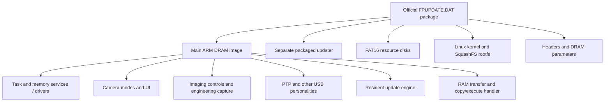

# How the X half firmware fits together

Consolidated 2026-11-03 from the linked research reports. This is the starting
point for understanding the system; the [RAM/recovery roadmap](ram-launch-and-recovery-roadmap.md)
tracks what must still be established before trying modifications.

## What we understand so far

The update file is a package of several components. The large ARM application
contains the camera UI, imaging controls, an operating-system/task layer,
hardware drivers, USB personalities, service commands and an update engine.
It also contains a RAM copy/execute mechanism. The package separately contains
an updater executable, resource disks, Linux and DRAM parameters.

We can explain selected behaviors as connected chains of instructions, not
just associate strings with addresses. We have not reconstructed all firmware,
observed those chains end to end on hardware, or established recovery.

For the stage/state/ownership map and the boot handoff contract, see
[boot architecture review, piece 1](boot-architecture-review.md). It is the
system-level companion to this guide.

## How to read the evidence

| Evidence | What it establishes | What it does not establish |
| --- | --- | --- |
| Artifact bytes / original instructions | A constant, branch, caller or operation exists in the identified image | The camera takes that path in its current state |
| Bounded original-instruction control | The included instructions behave as recorded with supplied state and explicit models | Physical hardware behavior, full task scheduling or all possible inputs |
| Live observation | The particular recorded camera/host interaction occurred | An unrelated interface works or the installed release matches our static image |
| Inference | A role is supported by call flow, data and diagnostics | A recovered manufacturer symbol, schematic or specification |
| Unresolved | Required evidence is missing | Proof that the feature or recovery mechanism cannot exist |

There is no complete camera emulator. Reports specify what executes, what is
modeled, where execution stops and which image hash the addresses belong to.
A passing control at one boundary does not make the next boundary safe.

## 1. Package and software organization

The boxes summarize identified contents, not a measured boot sequence or proof
that every compiled subsystem is used by this body. Linux is packaged and boot
preparation code exists; its full role during ordinary camera operation remains
unresolved. The camera application must not be treated as simply a Linux program.

The normal file-update path reaches the **resident update engine in the main
image**. The separate packaged updater is another executable; its presence in
the file does not prove the normal update UI launches it. Both can contain
related update/storage code without being the same boot stage.

Sources: [package/Linux inventory](update-package-and-linux.md),
[resident update path](resident-file-update-path.md),
[complete updater layout](updater-image-layout.md).

## 2. Hardware and address spaces

The main image identifies the platform as `SPCA6500` and the vendor stack as
iCatch/SP5K. ARMv7 startup, multiple-core entry code, SRAM usage and register
accesses are identified. Exact core count, sensor part, physical NAND part,
full RAM capacity and board wiring remain unresolved.

| Region / coordinate | Current understanding |
| --- | --- |
| CPU `0x100...` | Peripheral registers; individual blocks/fields have different evidence levels |
| CPU `0x10401000` / `0x10402000` | GIC interrupt-controller regions |
| CPU `0x3f000000..0x3f00ffff` | SRAM used for stacks, translation tables and copied code/data |
| Main CPU `0x40000000..0x40e383ff` | Packaged initialized DRAM image: code, constants and data |
| Runtime RAM beyond that image | Identified objects and initialization intervals, but incomplete ownership/size map |
| Low CPU addresses, including `0x00000b34` | Earlier-stage interface calls with unrecovered implementation/backing |
| DAT file offsets | Positions inside the update package, not CPU addresses |
| NAND offsets | Storage coordinates; require their own layout/geometry evidence |

The main image and complete updater are **both linked at `0x40000000`**.
An address without its image/version is ambiguous. Nor is an in-range RAM
address proof that an upload can overwrite it safely: stacks, live code, DMA
buffers and other cores may still use it.

The [bounded backing audit](low-helper-backing-boundary.md) further distinguishes
low physical memory from known SRAM copies: it does not recover the helper bytes,
and records the provider artifact needed to proceed.

Sources: [memory map](memory-and-hardware-map.md),
[hardware/boot diagrams](hardware-and-boot-diagrams.md),
[low-address helper](low-address-loader-helper.md).

## 3. Startup and earlier-stage boundary

The loaded main image's reset vector reaches `0x40000ec0`. Its startup sets
up processor state, SRAM stacks, translation/interrupt machinery and task
initialization. A loader-facing route also copies executable bytes into SRAM,
consumes an earlier-stage storage descriptor and loads/checks staged sections.
CPU clears and later hardware zero-fill requests explain how runtime RAM
objects are intended to be initialized.

These are different observed entry contexts; they must not be collapsed into
one proven power-on trace. The main-image reset vector is not the CPU's
immutable reset ROM. The earlier loader's actual bytes, boot-source selection,
validation and fallback decisions are still missing.

The storage descriptor is a useful interface contract: it carries primitive
pointers from earlier-stage SRAM, some of which the main image translates to
NAND functions. It does not tell us how to cold-boot from removable SD.

Sources: [staged storage handoff](staged-loader-storage-handoff.md),
[RAM initialization](staged-boot-ram-initialization.md),
[recovery-entry review](recovery-entry-review.md).

## 4. Camera modes, playback and the original feature goals

UI events and mode transitions call different imaging and drawing paths. The
main photograph and the secondary film-simulation label are separate outputs.
For lever review, a 2.00 temporary photo record leaves a new cached selector
at zero; zero selects Provia and bypasses metadata resolution. Older versions
resolve the simulation from metadata. This explains the reported mismatch
within reproduced instruction paths; no fix has been installed on the camera.

Auto ISO is a separate selector-to-range mapping. Auto 3 passes range code 7
(12800); code 6 (6400) already exists. Replacing that mapping is a narrow
candidate, while adding a preset involves more settings/UI paths. Engineering
RAW sensor-dump infrastructure also exists, but does not establish a hidden,
finished Fujifilm RAF feature.

These feature investigations are paused behind the execution/recovery work.
Sources: [lever defect](lever-provia-findings.md),
[four-version comparison](firmware-1.30-vs-2.00.md),
[Auto ISO](auto-iso-findings.md), [RAW](raw-support-assessment.md).

## 5. USB: an interface can exist without being reachable

Ordinary PTP and the application RAM loader use different selected internal
targets. In 2.00, API mode 3 selects PTP target 2; API mode 4 selects loader
target 0. Registering both sets of handlers does not make both accessible over
the current USB connection.

The physical camera has been identified as `04cb:030a`, and the restricted
standard GetDeviceInfo client completed an information request and explicit
session close. That is the established communication milestone. Loader identity
`2aad:6500` is statically expected, not a measured enumeration. The PTP reply's
`01.00` protocol version does not identify the installed Fujifilm release.

Normal PTP's inspected vendor-control slot is null, with no loader fallback.
The advertised operation review also did not establish a loader transition;
notably, opcode `0x9812` selects image processing here despite a generic MTP
name suggesting firmware update. A verified temporary retail transition remains
missing. Service/calibration and internal shell code are leads with access and
side-effect constraints, not established solutions.

Sources: [live information boundary](macos-device-info-session.md),
[retail routing](retail-usb-control-routing.md),
[advertised operation review](ptp-advertised-operation-review.md),
[loader receiver](xhalf-usb-ram-receiver.md).

## 6. RAM handoff is a replacement of the running environment

The receiver has memory-transfer and upload/run branches. Its completion path
can invoke an optional preparation callback, use a storage/header interface,
prepare a workspace stub, change mapping/cache/interrupt state, request a
hardware copy, call low helper `0x00000b34` and enter the replacement image.
The ordinary camera environment is not resumed if that payload simply returns.

The recent detailed traces explain several pieces of preparation:

| Piece | Connected finding | Remaining limit |
| --- | --- | --- |
| Optional callback | Calibration code can install backlight/lens/idle preparation; loader reset need not clear it | Actual runtime pointer and full effects unknown |
| Idle request | Queues mode change and waits on mode ID plus readiness | Dependencies/waits can prevent progress |
| Mode exit | Some candidate exits close playback tasks; others reach clock-related work | Actual provider/current mode unknown |
| Playback cleanup | Five named tasks; close errors can be ignored by the enclosing cleanup | Zero return does not prove complete shutdown |
| Termination hooks | Release owned mutexes and remove queue/event waits | Releasing locks can reach task-resume work |
| Idle clock path | Optional before/after callbacks, table gate, display-event wait and clock core | Real callbacks/table/hardware behavior unknown |
| Copy/execute | Guarded address conversion and copy-command construction traced | Physical copy, memory survival and low helper unresolved |

This is meaningful architectural progress: we now know why a call labeled
“idle” or “cleanup” cannot stand in for a complete safe-handoff proof.
The [roadmap](ram-launch-and-recovery-roadmap.md) ties each gap to a specific
missing piece of evidence instead of treating every callee as equally urgent.

Sources: [copy boundary](ram-handoff-copy-boundary.md),
[callback lifetime](main-loader-callback-lifetime.md),
[mode/sensor exits](main-sensor-and-mode-exits.md),
[playback cleanup](playback-cleanup-before-handoff.md),
[termination hooks](termination-synchronization-hooks.md),
[idle clocks](idle-clock-switch-and-callbacks.md).

## 7. Persistent storage, updating and recovery

An image running in RAM can still write persistent storage. We found concrete
reasons to keep these concepts separate:

- Calibration initialization can attempt a whole-buffer factory-data save even
  with automatic calibration disabled.
- A staged shared settings buffer can later be reloaded or included in an
  unrelated save. Archive caching/error masking also limits backup verification.
- Packaged updater NAND initialization can reach an erase-capable table builder
  under particular stored-metadata/read-error conditions before an explicit
  flash command.
- Firmware1/Firmware2 machinery and ordinary preservation of Firmware2 do not
  establish automatic cold fallback; generic write machinery can target both.

These are conditional static paths and bounded controls, not observed damage.
They explain why neither “RAM loaded,” “read-looking command,” nor “two slots”
is sufficient evidence of recoverability.

Recovery must work when the installed application cannot start. The application
USB loader, early shell inside that application, and vendor `sdboot` code do
not independently establish that property. No X-half cold SD/USB recovery
procedure has been verified within the user's non-invasive constraints.

Sources: [service-entry writes](service-entry-initialization-writes.md),
[shared settings](cold-buffer-lifetime.md),
[save-error limits](cold-save-error-propagation.md),
[updater initialization risk](updater-nand-initialization-risk.md),
[copy/fallback correction](updater-image-layout.md),
[risk assessment](brick-risk-and-recovery.md).

## Keeping this understanding usable

Read this guide for the model, the [roadmap](ram-launch-and-recovery-roadmap.md)
for research priorities, and individual reports for addresses and reproduction.
The README indexes them; `analysis/output/` retains selected evidence;
`analysis/scripts/` and Python helpers reproduce particular checks. Git records
changes and corrections. Original firmware/dumps/databases remain excluded.

For new findings, update the owning detailed report, then change the relevant
summary/roadmap status. Keep historical evidence, but label superseded mappings.
Avoid measuring progress by report count or passing-control totals: the useful
measure is which previously unresolved interface or safety requirement is now
supported by appropriate evidence.
