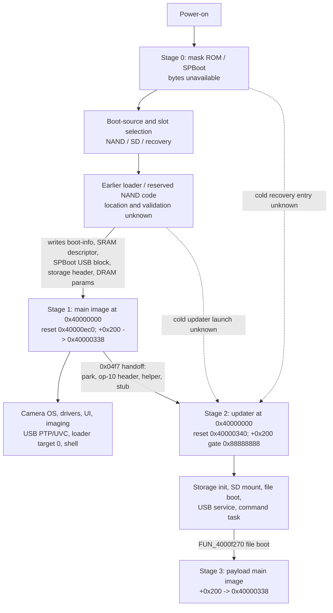

# Architecture review, piece 1: boot stages and the handoff contract

Date: 2026-11-06. Synthesis of existing evidence; no new camera
access. This is the first piece of a holistic review. It focuses on
the part the project has treated least systematically: **which boot
stage owns what, and what state is passed between stages**. The
detailed reports remain the source for addresses and controls.

Related: [architecture guide](architecture-guide.md),
[hardware/boot diagrams](hardware-and-boot-diagrams.md),
[memory map](memory-and-hardware-map.md),
[boot-info and updater SD boot](boot-info-block-and-updater-sdboot.md),
[staged storage handoff](staged-loader-storage-handoff.md),
[RAM handoff copy boundary](ram-handoff-copy-boundary.md),
[updater storage routing](updater-startup-storage-routing.md),
[SD mount trace](updater-sd-mount-trace.md).

## Why this piece

The project has been question-driven: trace a function, patch a gate,
run a push. That works for local questions, but the SD failure is a
**stage/state** problem: the main firmware's SD driver works, the
updater's does not, and the updater's controller reports card state
0 before any command. Patching the updater's `sdReMount`, SD init, or
ready gate did not change the outcome. The missing artifact is a map
of what each boot stage initializes, owns, and passes on.

## The stage model

The arrows are evidence-level mixed: the main-image loader path and the
updater's RAM-push path are observed/static; the earlier-stage and
cold-updater arrows are inferred. Stage 0 is the largest unknown.

## Stage table

| Stage | Entry / coordinates | Initializes or owns | Passes on | Evidence | Main gaps |
| --- | --- | --- | --- | --- | --- |
| 0. Mask ROM / SPBoot / earlier loader | Unknown bytes; SRAM remnants at `0x3f00c000`, `0x3f00c518` | DRAM init, boot-source/slot selection, storage descriptor, boot-info block, DRAM parameters; possibly SD/clock/GPIO init; **USB descriptor block** | Boot-info `0x10004000`, SPBoot USB descriptor block `0x3f00c000`, SRAM descriptor `0x3f00c518`, storage header, DRAM params `0x3f000200` | Inferred from the main image's loader-facing entry, SRAM dump, boot-info live read; SPBoot USB descriptors observed in SRAM | Bytes/behavior, selection/validation/fallback, updater cold source, low helper `0xb34`, descriptor producer, SPBoot entry/protocol |
| 1. Main image | Reset `0x40000ec0`; loader-facing `+0x200` -> `0x40000338` | CPU/SRAM/MMU/GIC/tasks, drivers, UI/imaging, USB personalities, loader target 0, calibration/debug, shell | Gate `0x12345678`; SD controller/task state; clock/power state; storage descriptor consumption; loader receiver | Static + live (loader, shell, boot-info, SD status) | Most of the RTOS/imaging/drivers; normal-vs-debug state; SD controller ownership; park stop list |
| 2. Updater | Reset `0x40000340`; `+0x200` gate `0x88888888` | Own CPU/SRAM/MMU/GIC/tasks, storage init, SD mount, file boot, USB service, command task | Gate `0x88888888`; service mode; file-boot attempt | Static + live (RAM-push 7/11, service mode, SD mount failure) | SD command/response state, driver state fields, FRM/ISP protocol, command-task transport, full startup effects |
| 3. Payload | `+0x200` / destination | Payload startup, staged sections, task init | — | Static + emulator; main image 0/4; updater 7/11 | Post-handoff environment; park/quiesce; earlier-stage descriptor/NAND state |

## The handoff contract

This is the table the project has never assembled in one place. It
distinguishes **observed live values** (calibration boot, 2026-11-05/06)
from static/inferred producers.

| Address / object | Size | Producer | Consumer | Observed / known | Confidence |
| --- | --- | --- | --- | --- | --- |
| `0x10001300` gate | 4 | payload `+0x200` | main/updater startup | `0x12345678` live | observed/static |
| `0x10004054` boot status | 2 | earlier stage | updater consumer | `0x0100` live (FW1, bit7 clear) | observed |
| `0x100040b4..b8` buttons | 5 | earlier stage | updater consumer | all zero live | observed |
| `0x100040b9..c3` mailbox | 11 | earlier stage / host? | updater consumer | empty live; set via trampoline | observed |
| `0x10000058` backend / media | 2 | earlier stage | updater storage routing | `0x0000` live (backend 0x00) | observed |
| `0x10004360..6a` SD controller | — | main firmware / controller | updater SD driver | `0x40`, `0x00`, `0x0200`, `0x15`, `0x00`, `0x00` live | observed; semantics partial |
| `0x3f000000` storage header | 512 | earlier stage or op-10 read | main-image staged loader | NAND RSV header in DRAM `0x40000c80` | static/live |
| `0x3f00c518` descriptor | 36 | earlier stage | main-image staged loader | valid `+0x1c=0x4654`, `+0x20=0x421c` | observed SRAM dump |
| `0x3f00c000` SPBoot USB block | ~0x100 | earlier stage / ROM | earlier stage / host | `SPBoot>` prompt, `2aad:6500` device descriptor, 167-byte config, interface 5 | observed in SRAM; entry/protocol unknown |
| `0x3f000200` DRAM parameters | — | earlier stage / updater | updater startup restore | restore gate-skipped when stamped | static |
| `0x3f00d000` helper block | 20 | handoff helper | copy stub | source, size, dest, params | static |
| `0x100002f0` secondary mailbox | 4 | reset code | secondary cores | spin-table/WFE | static |
| `0x100003a0` readiness | — | hardware | updater `+0x200` | gate-stamp condition | static |

The contract is **incomplete on purpose**: it lists what we know, and
makes the missing producers explicit. The boot-info block, SRAM
descriptor, storage header, and DRAM parameters are all inputs to the
main image/updater; their producer is the earlier stage, whose bytes
are unavailable.

## The SD failure through this lens

The SD dead end is now explainable without another gate patch:

1. The **main firmware's SD driver works** — the calibration entry
   reads `EnableTest.txt` from the card.
2. The **updater's SD driver** reads `0x10004365` low nibble `0` and
   the driver state field `0x400ba140+id*4+0x120`; it never reaches
   the command sequence. `0x40072914` waits on a completion that
   never posts.
3. The handoff contract does **not include the SD controller/task
   state**. The earlier stage, board init, or main firmware owns it.
   The updater's startup reinitializes CPU/SRAM/MMU/GIC/tasks, but
   not necessarily the SD controller/card state. The mode-`0x88`
   park stops tasks; it does not reset the controller.
4. The live observation is the **calibration/debug personality**.
   The normal retail boot's SD state is not measured. The debug
   personality may leave the controller idle (`0x10004365=0`) while
   the normal boot leaves it ready (`6`).
5. The updater's SD init (`0x4006ed88`) is unreferenced in the static
   image; the power callback `0x400ba2a0` is set only by that dead
   init or the SD shell command. The board/SD init that the main
   firmware's cold boot runs may be in the earlier stage or the
   main firmware's SD task, not in the updater.

This reframes the remaining SD options:

- **Fix the stage state**: find who sets `0x10004365` to `6` and
  whether the updater can inherit it. That is an earlier-stage /
  board-init / main-firmware-SD-task question, not another updater
  function patch.
- **Bypass the updater's SD driver**: use the main firmware's working
  SD driver (APITEST shell `read MAIN.BIN 0x41000000`) before the
  handoff. This is a system-level bypass, not a driver fix.
- **Accept the limit**: if the SD controller state is owned by the
  earlier stage and cannot be inherited after the RAM handoff, the
  updater's SD-file boot may be unreachable from the loader path.
  That is a finding, not a failure of effort.

## Open questions this piece exposes

1. Who produces the boot-info block and the SRAM descriptor? (Stage 0.)
2. What does the earlier stage initialize: DRAM, storage, SD
   controller, clocks, GPIO? What state does it pass?
3. What is the updater's cold-boot source and slot selector?
   (Reserved area C, SD, or ROM.)
4. What sets `0x10004365` to `6`, and when? Does the main firmware's
   SD driver leave it `0` at idle? Is the debug personality
   different from retail?
5. What does the mode-`0x88` park actually stop, and does it stop the
   SD task/controller? What state does it leave?
6. What is the normal retail boot's boot-info/SD state? (Not
   measured; the loader entry requires the calibration personality.)
7. What is the low helper `0xb34`, and what are the SPBoot USB
   entry conditions and command protocol at `0x3f00c000`?
8. What is the FRM/ISP device protocol, and can it query storage or
   boot state?

## What the next review pieces should cover

- **Piece 2: storage, slots, and recovery.** NAND header, Firmware1/
  Firmware2, reserved A/B/C, RawCBoot, updater residency, slot
  selector, cold recovery. The highest-value read-only evidence is a
  full storage dump plus the SPBoot USB/storage descriptor decode.
- **Piece 3: runtime subsystems and ownership.** RTOS/tasks, USB,
  SD/NAND, display, sensor/ISP, clock/power/DMA/GIC; which stage owns
  what; the park stop list; the normal imaging pipeline.
- **Piece 4: personalities and host interfaces.** Retail vs
  calibration/debug vs loader; PTP/UVC; the shell; the FRM/ISP host
  protocol.
- **Piece 5: feature lanes.** Lever/Auto ISO, Level 2 RAW, flash/
  recovery; what the architecture supports and what is blocked.

## Boundary

This is a synthesis of existing static, emulator, and live evidence.
No new camera access. The stage-0 arrows, the boot-info producer,
the slot selector, and the updater cold-boot source remain inferred
or unknown. The live values are from the calibration personality;
the normal retail boot's values are not measured.
