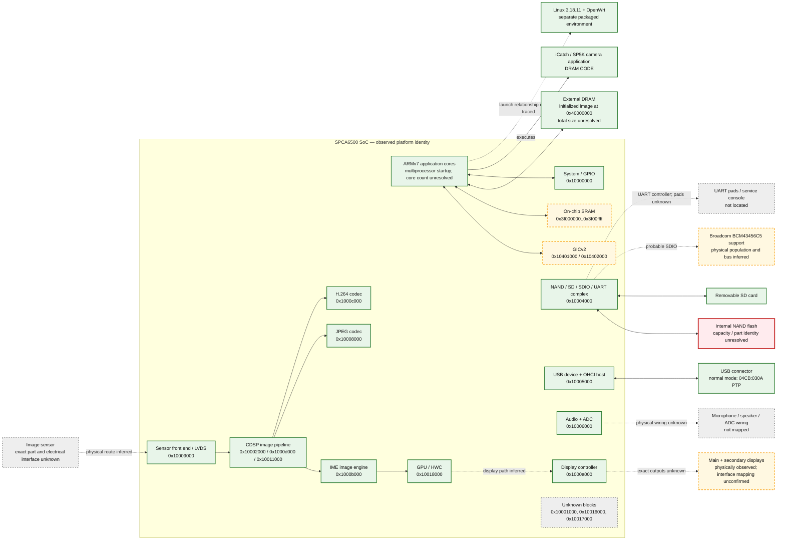
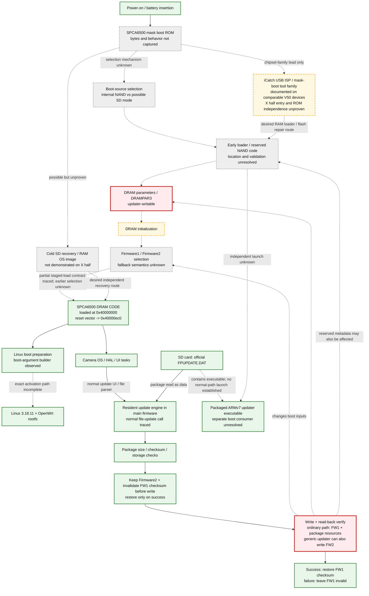
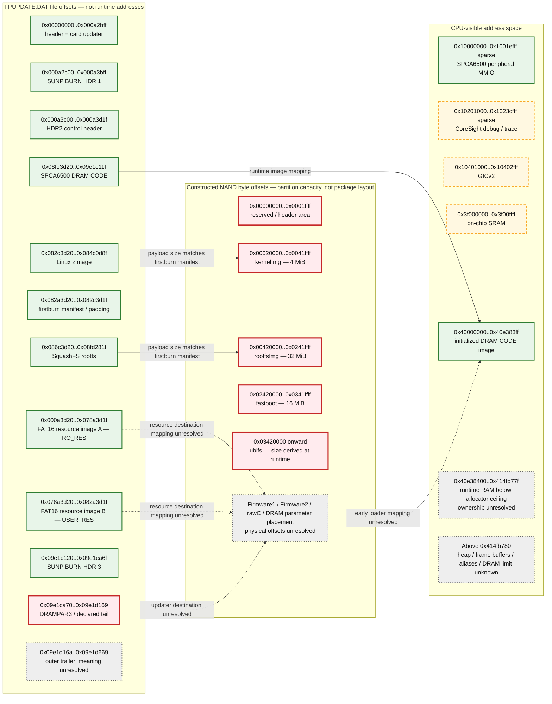

# Fujifilm X half hardware, boot, and storage diagrams

These diagrams are a living visual index of the evidence collected from X half
firmware 2.00. They do not represent a manufacturer schematic. A block can mean
"code for this hardware exists" without proving that the production camera
populates or wires every supported peripheral.

Artifact identities:

- `FPUPDATE.DAT` SHA-256:
  `3c1c662957003e5bab4f2a8fcb184180d72a92dbdec4fbeea030dac0df755d68`
- extracted `DRAM CODE` SHA-256:
  `80350bd2bc37b4ce985742ff85a747f7c7ad1ed9be401534ba57ac3262f1d923`
- complete card updater SHA-256:
  `4bdcdb060c89dcaa18b77d9d7b5f1a4e337627137f0b7c8d9a79a9dcf4048976`

Consolidation refresh: 2026-11-03. The updater hash previously listed here
(`e65576...df51`) identifies a historical shortened extract that omitted
`0x340` bytes. Use the [complete updater layout](updater-image-layout.md) for
current coordinates; old evidence retains its historical identity.
See the [architecture guide](architecture-guide.md) for the software model and
[RAM/recovery roadmap](ram-launch-and-recovery-roadmap.md) for current priorities.

## Legend

The labels remain authoritative if a renderer does not display colors:

| Appearance | Meaning |
| --- | --- |
| Green, solid | observed directly in the shipped artifacts or passive hardware enumeration |
| Yellow, dashed | derived or inferred from multiple observations |
| Gray, dotted | unresolved, absent from the package, or physical use unconfirmed |
| Red | updater-writable or otherwise boot-critical; not safe to treat as ordinary data |

"Observed" still means **static observation** unless a box explicitly says
passively observed on the physical camera. It does not mean we executed the
path.

## 1. Hardware-oriented block diagram

### Reading this diagram

- The image-processing route is a working subsystem model, not a recovered bus
  schematic. The MMIO block names are corroborated by matching HAL source-path
  strings and register accesses; the arrows between engines are partly inferred.
- The firmware contains drivers for more devices than the production body must
  necessarily contain.
- The Broadcom Wi-Fi files and drivers are observed in the root filesystem.
  The exact chip population and SDIO wiring have not been verified on hardware.
- `0x10007000` is intentionally omitted from the named pipeline. The firmware
  calls it `MAC`, but expanding that to “Ethernet MAC” would be speculation.

## 2. Boot, update, and recovery flow

The [staged storage handoff](staged-loader-storage-handoff.md) now identifies
application-side section loading/checks and an earlier-stage SRAM descriptor.
That narrows the loading arrow; it does not recover the earlier selector or
establish a successful physical cold boot.

### Safety boundary shown by the flow

The updater has verification and retry machinery, but it also reaches inputs
used before the main camera application starts. A successful package check is
therefore not equivalent to a recoverable update. The most important unresolved
arrows are:

1. how mask ROM selects and validates NAND or SD boot;
2. where the early/update loader resides and whether normal updating can damage
   it;
3. whether invalid Firmware1 automatically selects Firmware2; and
4. whether a cold SD image can run without the installed main firmware.

## 3. Three coordinate systems: package, NAND, and CPU addresses

These address spaces must never be mixed. Arrows below show only mappings that
have evidence; absence of an arrow means the mapping is unresolved.

### Confirmed NAND partition boundaries

| Partition | Capacity | NAND offset | Evidence |
| --- | ---: | ---: | --- |
| reserved/header | 128 KiB | `0x00000000` | kernel begins at fixed `0x20000` |
| `kernelImg` | 4 MiB | `0x00020000` | `firstburn` and boot-argument assembly |
| `rootfsImg` | 32 MiB | `0x00420000` | `firstburn` and boot-argument assembly |
| `fastboot` | 16 MiB | `0x02420000` | fixed boot-argument constant |
| `ubifs` | runtime-derived | `0x03420000` | follows the fixed partitions |

The zImage and SquashFS files are smaller than their partition capacities. The
diagram omits package padding regions between them for readability; the exact
file ranges remain in `update-package-and-linux.md` and
`output/firmware-regions.json`.

## 4. Current evidence and unknowns ledger

| Area | Established | Still unknown |
| --- | --- | --- |
| CPU startup | ARMv7 little-endian DRAM image, reset vector, secondary-core entry, SRAM stacks, VBAR and GIC setup | core count; pre-DRAM execution stages |
| Memory | initialized image extent; on-chip SRAM role; allocator ceiling `0x414fb780` | complete DRAM size; BSS ownership; safe upload ranges; framebuffer locations |
| Imaging | sensor front end, CDSP, IME, JPEG, H.264, GPU/HWC and display MMIO blocks | exact sensor part; engine interconnect; main/secondary display routing |
| Storage | active NAND/SD code; Linux partition construction; package zImage/rootfs | NAND part/capacity; FW1/FW2/rawC physical placement; bad-block metadata |
| USB | normal physical camera enumerates as PTP `04CB:030A`; separate UVC/EUC code exists | safe service-mode entry; UVC selector source; read-only debug transport |
| Linux | exact kernel and rootfs; OpenWrt inventory; Broadcom support files | normal runtime role; actual network interfaces; exposed UART pads |
| Update safety | package checksum algorithm, shared FW1/FW2 writer, read-back comparison, retries, backup strings, FW1 checksum messages; HDR2 FAT A/B layout | outer-trailer validation; automatic fallback; power-loss recovery |
| Recovery | FujiMod proves SD recovery on other processor families; comparable V50 tools distinguish mask/ISP boot and USB bulk/null modes | X half SD/USB entry chord, boot-ROM contract, ROM independence, and recovery image |

## Source reports

- [`architecture-guide.md`](architecture-guide.md)
- [`ram-launch-and-recovery-roadmap.md`](ram-launch-and-recovery-roadmap.md)
- [`updater-image-layout.md`](updater-image-layout.md)
- [`staged-loader-storage-handoff.md`](staged-loader-storage-handoff.md)
- [`memory-and-hardware-map.md`](memory-and-hardware-map.md)
- [`hardware-register-blocks.tsv`](hardware-register-blocks.tsv)
- [`update-package-and-linux.md`](update-package-and-linux.md)
- [`output/firmware-regions.json`](output/firmware-regions.json)
- [`brick-risk-and-recovery.md`](brick-risk-and-recovery.md)
- [`spca6500-package-and-recovery-comparison.md`](spca6500-package-and-recovery-comparison.md)
- [`xhalf-usb-identity.md`](xhalf-usb-identity.md)
- [`ptp-and-service-command-paths.md`](ptp-and-service-command-paths.md)
- [`uvc-service-mode-activation.md`](uvc-service-mode-activation.md)

## Maintenance rule

When a new fact changes a box or arrow:

1. update the detailed source report first;
2. change the diagram's label and confidence style;
3. add or remove the corresponding unknown in the ledger; and
4. preserve the artifact hash and distinction among package offsets, NAND
   offsets, and CPU addresses.
