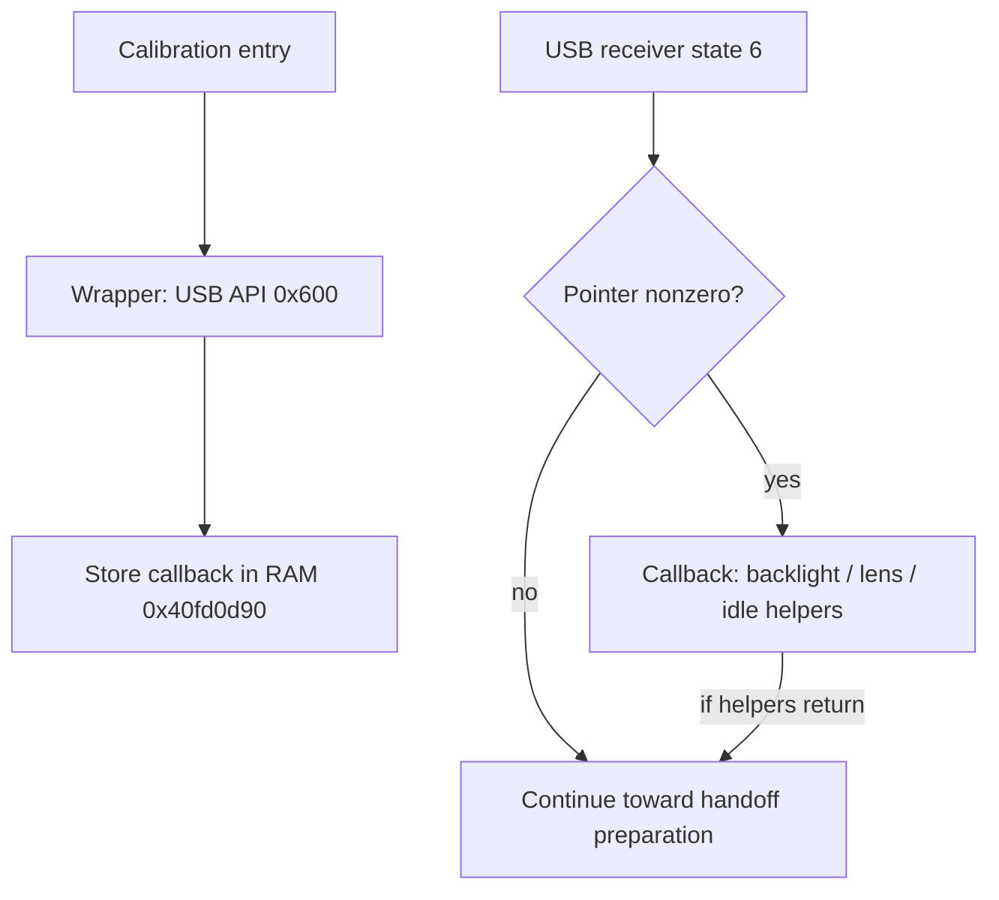

# A calibration path installs camera-state preparation before RAM handoff

Date: 2026-11-03. Offline original ARM and five local Ghidra controls of
2.00 **main image**, SHA-256
`80350bd2bc37b4ce985742ff85a747f7c7ad1ed9be401534ba57ac3262f1d923`,
base `0x40000000`. Every routine address below belongs to MAIN, not updater.
No camera access or firmware changes.

## Finding

Follow-up: [callback lifetime](main-loader-callback-lifetime.md) shows that
registration and two reset initializations preserve supplied callback values
under empty auxiliary-state fixtures. Full startup separately requests a
stage-23 zero fill covering the slot. Actual live value remains unobserved.

A concrete producer of the previously unresolved pre-handoff callback is
identified. Calibration-entry routine `0x405dd4f0`, whose actual diagnostic
says `EnterCalibrationMode`, calls wrapper `0x405dd4e0`. That wrapper passes
USB API selector `0x600` and function pointer `0x405da53c` to the USB API
multiplexer. Its setter stores the pointer at RAM `0x40fd0d90`.

The USB receiver's state-6 branch calls that pointer when nonzero before the
[handoff preparation](main-handoff-usb-state.md). The callback invokes three
helpers: a backlight-related API with argument zero, a routine identified by
`UICloseLens` diagnostics, and a routine requesting idle mode. This is broader
camera-state preparation, not an identified USB detach or PHY shutdown routine.

Five controls establish registration, optional dispatch/skip, clearing through
the API, and callback call order with its callees modeled. They do not execute
calibration startup, lens work, idle transition or any physical camera operation.
The callback's actual presence during ordinary retail operation remains unknown.



These are static edges with bounded software controls, not a measured camera
startup or a way to enter calibration mode.

Follow-up: the [idle transition audit](main-idle-mode-handoff.md) identifies
asynchronous mode exits and conditional DRAM-clock changes. Five bounded controls
verify guards/readiness boundaries, not the complete transition or storage safety.

## Registration route and variadic entry

Original calibration routine `0x405dd4f0` logs the calibration-entry string at
`0x40c01a12`, makes several other calls, and calls registration wrapper at
`0x405dd534`. The wrapper:

```text
405dd4e0  load r1 = 0x405da53c
405dd4e4  r0 = 0x600
405dd4e8  tail-call 0x4038ddb0
```

The USB API's real variadic entry is `0x4038ddb0`, which first saves `r0..r3`.
The next prologue is `0x4038ddb4`; using that second address as the callable
entry misses the argument-save instruction. The original switch recognizes
selector `0x600`, reaches `0x4038e1e0`, loads the saved argument into `r0`, and
calls `0x401e20f4`. That setter writes receiver-state `0x40fd0d50 + 0x40`.

An initial caller search aimed at `0x4038ddb4` found no direct callers because
it was four bytes past the actual entry. Searching the correct entry exposes
the wrapper above. This is an entry-boundary correction, not evidence of an
unreachable API or a hidden transport.

A bounded scan of aligned direct B/BL callers in `[0x40000000,0x40ab0000)`
plus a preceding 32-instruction immediate-argument window identified this
selector-`0x600` wrapper. It is an identified positive producer, not an
exhaustive inventory of indirect/computed API calls or writes to the callback
slot. The setter itself has the direct caller shown above; no claim is made
that ordinary operation always installs or always lacks this callback.

## Callback behavior: what is identified and what remains open

Wrapper `0x405da53c` executes these calls in order:

| Call | Evidence | Limit |
| --- | --- | --- |
| `0x40205fc4(0)` | Its zero branch enters `0x40205dd0`, which calls API `0x40042fb0(2, 0x1f, 0)` and logs `BackLightOn %x`; a backlight-level request is the supported interpretation | Exact device/electrical effect and deeper API side effects are not audited |
| `0x405e6fa0()` | Actual strings include `UICloseLens`, `Wait Lens Stop`, and `lens close finish`; code checks state, invokes lens-related helpers and has wait/retry branches | Does not establish mechanical movement on this body, bounded return time, or absence of persistent side effects in all callees |
| Tail-call `0x4015bf04()` | Checks mode `0x88`; diagnostics say `Set IDLE MODE`; non-idle branch invokes mode-transition helpers | Full transition/save/storage/controller effects remain unaudited |

The function named by `UICloseLens` can return early on a state check and also
contains loops driven by helper results. Merely seeing the outer callback
return in a model must not be described as a measured successful lens operation.
Likewise, idle-mode preparation is not proof of complete task, storage or USB
shutdown.

None of these three outer call edges is the known main USB PHY release helper
`0x400250b8`. That limited observation is not a negative proof about their
transitive/indirect callees. The earlier handoff controls modeled none of this
callback; their supplied PHY-preservation result cannot be extended backward
through it without further work.

The receiver invokes the callback at `0x401e1f54` and then continues at
`0x401e1f58` if it returns. A null pointer skips the call. The callback's runtime
value, entry into calibration startup and possible later overwrites have not
been observed on the camera. Registration in a calibration path does not prove
that path is accessible in normal PTP operation.

## Five bounded controls

[InspectMainHandoffCallback.java](scripts/InspectMainHandoffCallback.java)
executes original instructions against synthetic RAM:

1. Registration wrapper -> complete variadic API entry -> setter: pointer
   `0x405da53c` appears at `0x40fd0d90`.
2. State-6 optional-call branch with that pointer: stop at callback entry,
   before its first instruction.
3. Original API selector `0x600` with argument zero clears the emulator slot.
4. State-6 branch with null pointer skips to `0x401e1f58`.
5. Original callback wrapper calls the three helpers in order, with first
   argument zero; all three helpers are modeled as returning.

All five pass. Only the fifth control models helper calls; none executes those
helpers. All loaded-image bytes are checked unchanged and source binaries are
untouched. No calibration initializer, USB transport, scheduler, mode change,
backlight/lens operation, controller, NAND/SD, payload or camera executes.
Clearing the emulator callback is a control, not a live-camera instruction.

```sh
GHIDRA_PROJECT_DIR=/private/tmp/fuji-ghidra-v7 GHIDRA_PROJECT_NAME=FujiV7 \
  bash analysis/run-ghidra.sh -process firmware-main.bin -noanalysis -readOnly \
  -postScript InspectMainHandoffCallback.java /private/tmp/main-handoff-callback.txt
```

Evidence: [five controls](output/main-handoff-callback.txt),
[main-image-qualified static ranges and actual strings](output/main-handoff-callback-static.txt).
No new REA or live observation is claimed.

The previously unknown pointer now has a concrete producer and a partial
behavioral identity. The next material questions are whether ordinary loader
initialization clears/preserves that slot, and whether the idle transition or
backlight/lens helpers can reach persistent storage or USB resource changes.
Neither a safe RAM launch nor independent recovery is established. The camera
can remain unplugged.
