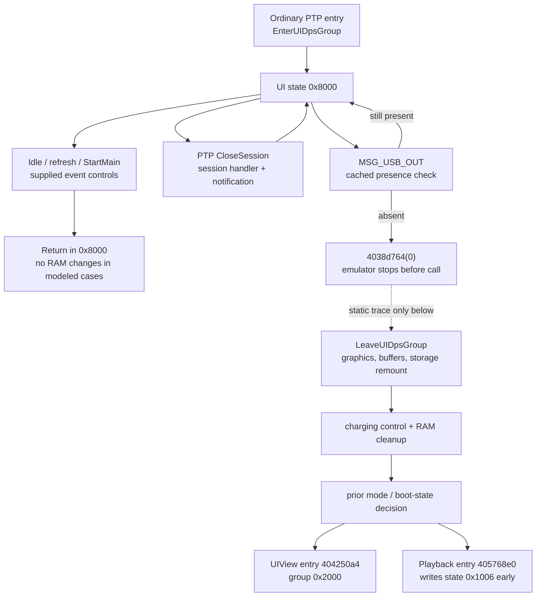

# PTP UI state, refresh controls and USB-out ordering

Date: 2026-11-01. Offline only; no camera access. Official 2.00 main image
SHA-256: `80350bd2bc37b4ce985742ff85a747f7c7ad1ed9be401534ba57ac3262f1d923`.
ARM runtime addresses, base `0x40000000`.

## Finding

The inspected ordinary PTP entry selects UI state `0x8000`. In that state,
the full application dispatcher returns without changing RAM for each of
the proposed idle, refresh and `StartMain` events, under the modeled runtime
conditions. A RAM-staging request does not itself make startup-state handlers
available. This closes an important reachability gap in the earlier synthetic
composition: simply waiting for idle or closing the PTP session is not an
established way to refresh this flag while remaining in ordinary PTP mode.

USB-out takes a distinct path. It checks cached connection state, then calls
USB disconnect, UI cleanup, storage remounting and charging control before
choosing a normal camera-mode entry. Neither a full safe exit nor preservation
of staged settings through all these callees is established.



The diagram is a bounded static/control-flow map, not observed camera
behavior. The CloseSession notification controls do not reproduce the actual
USB transfer or complete application loop.

## Ordinary PTP entry and saved mode

`0x405c9c18` stores its incoming prior mode at `0x413d3c90` and
`0x413cb3e4`, sets UI state `0x8000`, clears small UI fields and calls
`0x405c8f64`. The latter's embedded name is `EnterUIDpsGroup`.

The entry routine checks the factory-operation marker and initializes PTP,
then, on its connected branch, disconnects USB, selects API mode 3 and
configures callbacks. At `0x405c9198..0x405c91b4` it sets UI state `0x8000`
and its substate halfword to zero. There is an earlier conditional return
while mount/resource work remains outstanding. These observations do not
prove the live camera stays in exact substate `0x8000` throughout a session.

The existing factory callback's `0x1027` staging branch changes shared cold
RAM, not the UI state or the cached USB-selection byte. Its registration and
transport prerequisites remain as described in the earlier PTP notes.

## Refresh candidates tested through the application dispatcher

The expanded [ReproducePtpSessionNotifications.java](scripts/ReproducePtpSessionNotifications.java)
enters at `0x40400d50`, rather than jumping directly to a UI sub-handler.
It supplies state `0x8000`, connected cached USB presence, staged cold data
and both USB-selection byte values. The original path is:

```text
40400d50 -> 404db31c -> 404d665c -> 405c9718 -> return
```

`0x405c9718` is named `UIMode_DpsCreateHandler` by its shipped diagnostic.
Only logging is stubbed. The test snapshots and compares the entire image
and global region `0x40000000..0x413fffff`; the emulated stack is elsewhere.

| Supplied event | Meaning / earlier hypothesis | Both flag controls |
| --- | --- | --- |
| `0x62510018` | OpenSession notification | Return, region unchanged |
| `0x62510019` | CloseSession notification | Return, region unchanged |
| `0xf0000071` | Idle timeout | Return, region unchanged |
| `0xf2000084` | Refresh event that works in group zero | Return, region unchanged |
| `0xf2000000` | `StartMain` event that works in exact state 1 | Return, region unchanged |

These ten cases exclude queue/filter delivery, diagnostic wrappers around
the main dispatcher, real timer generation, concurrent activity and other USB
substates. They establish neither universal event inertness nor a technique
for sending UI events from a host. They show that the tested events do not
bridge the PTP-state/startup-state gap under these conditions.

## USB-out boundary and ordering

The script also supplies `0xf0000045` (`MSG_USB_OUT`) through the same main
dispatcher. For both USB-selection flag values:

- Cached presence 1 returns before disconnect and leaves the snapshot unchanged.
- Cached presence 0 reaches `0x4038d764` with argument 0. The test stops
  **before** that call and checks the unchanged snapshot. No teardown helper
  is modeled as a successful return.

The cached-presence getter `0x40123bf8` executes original instructions over
the supplied byte `0x40e7ab8c`. This is not the raw USB MMIO presence input.
The four cases plus the ten above all passed. Retained output:
[ptp-ui-refresh-controls.txt](output/ptp-ui-refresh-controls.txt).

Beyond that stop, the original instructions show this order:

| Location | Action / boundary |
| --- | --- |
| `0x404d68ec..0x404d68f0` | USB disconnect `0x4038d764(0)` |
| `0x404d68f4` | `LeaveUIDpsGroup`, `0x405c92c8` |
| Inside leave helper | Free populated UI buffers; conditional event/semaphore cleanup; graphics work |
| `0x405c9380` | `0x405365fc`, named `MountStoreMemory` in its own diagnostics; result stored in UI mount-status halfword |
| `0x405c93a0..0x405c93dc` | Storage-status formatting, queue/filter work, display-object cleanup, cached UI-presence byte clear |
| `0x404d68f8..0x404d68fc` | Charging control `0x40124b74(1)` |
| `0x404d6900..0x404d6958` | More UI RAM cleanup, conditional display setup and runtime USB-state reset |
| `0x404d695c..0x404d69c0` | Choose a normal camera-mode entry based on prior mode and boot state |

The directly visible stores in these top-level routines do not refresh USB
selection byte `+0x101d`. That is not a complete transitive claim about all
callees. They also do not establish immediate revocation of registered factory
PTP operations; session close and marker removal remain separate questions.

## Remount and return-mode details

`MountStoreMemory` calls `0x40021a08`, bracketed configuration work through
`0x40123b10`, conditional `0x40535fbc` and `0x40535de4`, and status helper
`0x405365b4`. The mount worker includes storage API calls at:

```text
40536058 -> 400bd1f8
40536134 -> 40233cb8
40536158 -> 40233d14
40536178 -> 40233d58
```

The precise media metadata writes and error/retry behavior below these APIs
remain unaudited here. The existence of these calls is not proof that an
unplug operation rewrites factory data, nor proof that it performs no storage
writes. The emulation does not run this remount path.

The return decision reads the prior-mode halfword at `0x413cb55a`
(`0x413ca9f8 + 0xb62`):

- Prior group `0x1000` selects playback entry `0x405768e0`, after a display
  helper. That entry is identified by `EnterUIPlaybackGroup` and writes state
  `0x1006` at `0x40576938`.
- Prior group zero also selects that entry when boot-state word `+8` equals
  2; otherwise it selects `0x404250a4`.
- Other prior groups select `0x404250a4`, identified by `EnterUIViewGroup`.
  Inspected paths in that routine write group state `0x2000`.

Neither is a direct call to the startup-state `StartMain` handler. Their
complete initialization, error paths and subsequent asynchronous events are
outside this trace. The prior-mode halfword used for this decision is distinct
from the saved value at `0x413d3c90`; they should not be conflated.

## Reproduction and consequence

```sh
GHIDRA_PROJECT_DIR=/private/tmp/fuji-ghidra-v7 GHIDRA_PROJECT_NAME=FujiV7 \
  bash analysis/run-ghidra.sh -process firmware-main.bin -noanalysis \
  -postScript ReproducePtpSessionNotifications.java /private/tmp/ptp-ui-refresh-controls.txt

python3 analysis/fw.py disasm 0x404d68bc 0x404d69c4
python3 analysis/fw.py disasm 0x405c92c8 0x405c9414
python3 analysis/fw.py disasm 0x405365fc 0x4053679c
python3 analysis/fw.py disasm 0x4057692c 0x4057693c
```

Original-byte disassembly and the existing local Ghidra project were reused
after the documented REA raw-image mapping limitation. No device runtime or
new REA runtime evidence is claimed.

The current RAM-staging hypothesis needs a real route from an accessible
PTP state to a qualified flag refresh. The tested idle/session/startup events
do not supply it. USB-out introduces teardown/remount/peripheral work and
returns toward other camera modes, so it cannot be abbreviated to “refresh
and reconnect.” The next relevant offline targets are the selected return-mode
entry and its USB-reentry behavior, plus the exact filesystem effects that
determine whether temporary settings survive that cycle. Safe activation and
independent recovery remain unresolved.
