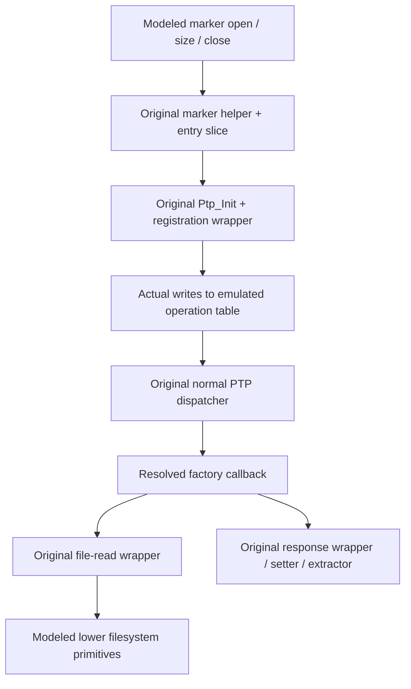

# Marker to factory read: integrated firmware emulation

2026-11-03. Offline original-ARM emulation of official 2.00. No camera commands,
SD markers, physical storage reads/writes or firmware changes were performed.

## What this adds

Earlier controls tested registration and the factory callback separately. This
pass connects them in the **same emulated memory instance**: a modeled marker
open leads through the original marker check and initializer, actual registration
writes populate the command table, and requests then enter the normal dispatcher.
The callback pointer is resolved from that populated table, not substituted by
the test. Response values are built and extracted by original firmware code.

Eight integrated checks pass. The bounded successful acquisition reconstructs
all 1,024 bytes of a synthetic disk record through 64 dispatched chunk requests.
This closes a software routing gap; it does not demonstrate an actual SD-marker
activation, a USB transfer or a RAM-loader entry.



The graph is an emulated software dependency path. It omits real USB, complete
startup, concurrent tasks and physical filesystem/controller behavior.

## Evidence and reproduction

Official 2.00 main SHA-256:
`80350bd2bc37b4ce985742ff85a747f7c7ad1ed9be401534ba57ac3262f1d923`,
ARM little endian, base `40000000`. The script reads and verifies the full image
from the existing Ghidra 12.1.4 project before executing any control. It uses the
same local Ghidra/p-code fallback as the [marker review](ptpap-marker-activation-review.md);
no new REA session/decompilation result is claimed.

- [Emulator script](scripts/ReproducePtpFactoryDispatch.java).
- [Retained control output](output/ptpap-dispatch-controls.txt).
- [Dispatch/response instruction excerpts](output/ptpap-dispatch-instructions.txt).
  Cached ELF bytes were compared equal to the full raw main before this export.

```sh
GHIDRA_PROJECT_DIR=/private/tmp/fuji-ghidra-v7 GHIDRA_PROJECT_NAME=FujiV7 \
  bash analysis/run-ghidra.sh -process firmware-main.bin -noanalysis -readOnly \
  -postScript ReproducePtpFactoryDispatch.java /private/tmp/ptpap-dispatch-controls.txt
```

This runs firmware instructions in Ghidra's ARM p-code emulator on the computer.
It contains no USB backend and cannot connect to the camera. The output path is
a local report, not a firmware patch or camera upload.

## Executed versus modeled

| Component | Treatment |
| --- | --- |
| Marker check `405219cc`, size wrapper `4015c52c` | Original instructions; low-level marker open/size/close modeled |
| Entry slice `405c9030..405c9044` | Original instructions; starts after preceding mount/resource checks and stops before later USB/UI setup |
| `Ptp_Init`, `405ca428` | Original branch/registration code; shared configuration and callback-installation calls modeled as returns |
| Registration wrapper `405e6868`, writer `402e753c` | Original instructions for selector `100`; actual emulated table writes |
| Dispatcher `402e778c`, table lookup/mode/alias/support checks | Original instructions; no direct jump from the request fixture to the factory callback |
| Factory callback `405ca67c` | Original instructions on selected read paths; negative write control stops before persistent writer |
| File wrapper `40125d94 -> 4015ba48` | Original argument handling, open/size/seek/read/close sequencing and error logic |
| Filesystem open/size/seek/read/close | Fixed synthetic handles and data; no archive adapter, real files, storage driver, NAND or SD execution |
| Response wrapper `405e6ac0`, setter `40334f34`, extractor `40334f9c` | Original instructions, including five-parameter response packing into emulated RAM |
| Logging, first-use helper `4015b5f8`, memcpy/memset, notification delivery | Explicit stubs; notification application/UI effects not executed |

RAM/global defaults, stack, request buffers and the disk record are synthetic.
Request fields and dispatcher output arguments are supplied directly; no USB
packet parser or physical host-session state is reproduced. A 64-byte request
fixture zeroes unused parameter slots, while encoding a 16-byte command with one
parameter. This does not qualify malformed/short live transport buffers.

The emulator admits explicit code ranges and stops before unexpected callees.
The forbidden-write control specifically expects the `40125e4c` boundary. It
never models that writer as successful. These are bounded execution controls,
not a whole-program proof or an emulator for all camera hardware.

## Results

| Case | Observed inside the model |
| --- | --- |
| Marker absent, fresh empty registration table | Dispatcher returns `2005`; no factory callback or file read; cached buffer preserved |
| Marker present, `1027(0)` | Dynamic lookup invokes `405ca67c`; `2001` plus five parameters contains first 16 cached bytes; no file read |
| Marker present, `1025(0)`, lower read succeeds | Original wrapper reports internal status 0; fills the 1 KB buffer; PTP response `2001`, zero parameters |
| Following 64 bounded `1027` reads | Offsets `0,16,...,1008` reconstruct the synthetic disk record exactly; buffer and operation table remain unchanged; no further file reads |
| Remove marker, rerun entry slice, then probe | Marker flag becomes zero, but dispatcher still resolves the previously registered read handler |
| Selected CloseSession, then direct dispatcher probe | Registration remains reachable at this software boundary; this does **not** prove that a real host can issue requests without reopening a session |
| Lower factory-file open fails | Wrapper status 1 is ignored; dispatcher still produces `2001`; the next chunk returns the old cache unchanged |
| Synthetic negative `1025(1)` control | Dispatcher reaches persistent writer entry `40125e4c`; execution stops **before** that writer |

The synthetic disk pattern is deliberately different from initial cached RAM and
has the previously identified weak checksum. Equality against that supplied
pattern tests reconstruction; it says nothing about any real camera's flags,
serial, calibration values or the authenticity/freshness of a physical read.
No synthetic flag values are interpreted as camera observations.

The failed-open result confirms the existing freshness limit through the newly
connected path. Neither the dispatcher nor response-state construction repairs
the ignored file error. The model cannot turn `2001` into evidence of a real
successful file read.

## What remains before a physical experiment

The software connection is now demonstrated under the stated fixtures. The main
remaining physical questions are still: whether the real marker is seen on the
correct mounted medium; complete USB entry/exit and restart behavior; actual
storage-read freshness; and control of host-generated PTP traffic while write
commands are enabled. The current ImageCapture helper's automatic traffic remains
unmeasured. This emulator cannot resolve those facts by assigning them successful
stub results.

A useful next offline extension would replace a **specific** remaining model with
original code, such as shared initialization configuration or notification delivery,
where it answers a concrete activation-risk question. Independent host-traffic
qualification and a later activation/deactivation test remain separate work.
This pass establishes neither RAM boot nor recovery, and does not justify service
entry or modified firmware flashing.
