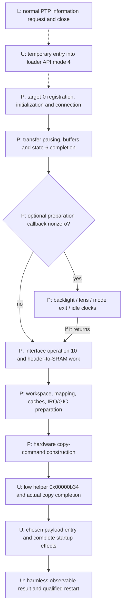
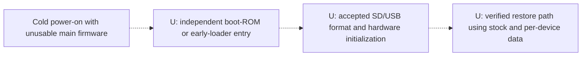

# RAM launch and recovery: evidence map and priorities

Consolidated 2026-11-03. Read the [architecture guide](architecture-guide.md)
first for subsystem context. This document synthesizes existing findings; it
adds no camera experiment, executable payload or new binary-analysis result.
All technical addresses below refer to the hash-qualified 2.00 reports linked
from the tables, unless explicitly marked as updater.

## Two outcomes, with different requirements

**Temporary RAM execution:** start controlled replacement code while accounting
for all persistent effects of entry, handoff and payload. The installed camera
software may still be needed to enter this path.

**Independent recovery:** enter a known restore path after a cold power cycle
even when the installed application cannot boot, and restore the necessary
firmware plus device-specific data.

The first does not imply the second. We have an application-level RAM-loader
lead and many analyzed components, but neither outcome is established end to
end. RAM execution can be investigated before cold recovery is established;
neither milestone alone authorizes modified flashing.

## Proposed application RAM-launch path

Legend: **L** = the specified limited live interaction occurred; **P** = partial
static/controlled understanding; **U** = required behavior unresolved. A P box
can contain known operations without the complete box being qualified safe.
Arrows show the proposed dependency chain, not a recorded successful session.

Normal PTP cannot be assumed to dispatch loader requests. The two interfaces
are separated by target selection. Likewise, null callback state is not a
usable bypass until its real value/lifetime is established on the chosen route.

| Stage | What is supported | Evidence still needed |
| --- | --- | --- |
| Normal communication | Camera identity and a restricted standard-information session | This does not qualify vendor transport or attest the installed release |
| Loader selection | API mode 4 maps to target 0; mode-selection code/cached flag identified | A reachable, temporary, nonpersistent entry from the actual retail state |
| Service construction | Registration and multiple reset/construction paths traced | Real descriptors, initialization, hardware state and transport behavior on that route |
| Transfer/receiver | Parsing, transfer direction and selected queue boundaries reproduced | Validated protocol/state, lengths, workspace allocation and full error behavior |
| Optional preparation | Producer/lifetime and several mode/task/clock dependencies traced | Actual pointer/state plus remaining lens/sensor/clock and concurrent effects |
| Final preparation | Boot fields, resource request, workspace/MMU/cache/GIC operations identified | Interface operation 10, complete storage/header effects and compatible inherited hardware state |
| Copy and low helper | Conversion/command metadata and helper arguments identified | Source/stack/stub survival, physical completion, helper bytes/mapping/effects |
| Payload | Different main/updater special entries and some startup paths identified | A specific minimal payload with audited startup, persistence and restart behavior |

Sources: [live session](macos-device-info-session.md),
[selection/routing](retail-usb-control-routing.md),
[receiver](xhalf-usb-ram-receiver.md),
[initialization](early-usb-startup-dependencies.md),
[callback lifetime](main-loader-callback-lifetime.md),
[preparation](main-handoff-usb-state.md),
[copy/entry](ram-handoff-copy-boundary.md),
[low helper](low-address-loader-helper.md).

## Independent recovery is a separate lane

The existence of mask ROM, two firmware slots, other iCatch recovery tools or
a function called `sdboot` does not supply any missing arrow. The X half's
low-address implementation and exact boot-source/validation contract remain
unrecovered. The user excludes opening the body, UART wiring and repair-lab
acquisition; those are not fallback work items for this project.

Sources: [recovery-entry review](recovery-entry-review.md),
[public-artifact review](public-boot-artifact-review.md),
[risk assessment](brick-risk-and-recovery.md).

## Ranked blockers for temporary execution

Ranks express research importance, not a bricking probability. Ordering a
blocker first does not mean it is easiest or that another static trace can
supply the missing evidence.

| Rank | Blocker | Why it matters | Evidence that would close or materially narrow it |
| --- | --- | --- | --- |
| R1 | Qualified retail-to-loader entry | Without entry, the analyzed receiver cannot be used | A traceable route for this body whose activation and persistence effects are understood; existing PTP/session success is insufficient |
| R2 | Earlier-stage helper/backing | The final path calls code whose bytes and full effects are unknown | Authentic bytes plus mapping/provenance for the low helper, or a fully evidenced alternative that avoids it |
| R3 | Memory ownership and hardware transition | Overwriting live RAM can destroy the stub, stack, data or other users | A complete chosen-route map of allocations, overwrite intervals, other cores/DMA, cache/interrupt state and real copy behavior |
| R4 | Preparation and runtime state | Optional callbacks and mode/clock work may block or add effects | Determine which branches actually apply, then audit their complete effects; closing every unrelated SDK function is unnecessary |
| R5 | Payload startup and restart | A RAM-resident payload may still erase flash or leave no functioning return path | A specific controlled diagnostic with known entry/startup/outputs and restart behavior; stock updater is not assumed harmless |

R1 and R2 are major access/evidence gaps. R3–R5 are needed to qualify a proposed
launch even if access becomes available. Recent task and clock findings mostly
narrow R4; they do not close R1 or prove independent recovery.

The stock updater is a concrete R5 counterexample: conditional NAND startup can
reach erase-capable table construction. Its USB continuation can be studied in
isolation, but direct entry to that continuation is an emulator fixture, not a
verified safe hardware-entry method.
Sources: [NAND initialization](updater-nand-initialization-risk.md),
[USB/storage distinction](updater-usb-storage-separation.md).

## Ranked requirements for recoverable flashing

These remain separate from application RAM execution:

| Rank | Requirement | Missing proof |
| --- | --- | --- |
| C1 | Cold entry independent of installed main firmware | Exact X-half entry conditions, accepted medium/protocol and executable boot path |
| C2 | Surviving restore mechanism | Which boot/DRAM/layout components an update can damage and how the independent path restores them |
| C3 | Complete per-device backup | Correct storage scope, bad-block/layout metadata, calibration/settings, independently verified persistence and restore semantics |
| C4 | Valid modified package | All relevant integrity/validation fields, including unresolved outer structure, and reproducible no-op reconstruction before a patch |

Ordinary updater checks, read-back/retry and Firmware2 preservation help explain
its design. They do not establish C1/C2. A stock DAT file does not supply
per-device calibration or prove C3. Archive caching and error masking mean a
successful logical read/write reply alone cannot verify a backup or restore.
See [risk assessment](brick-risk-and-recovery.md),
[archive backing](cold-resource-backing.md) and
[save errors](cold-save-error-propagation.md).

## Known entry leads: what has already been checked

| Lead | Existing conclusion | What would justify reopening it |
| --- | --- | --- |
| Standard retail PTP / advertised operations | Reviewed handlers do not establish loader selection; no vendor-control fallback | A new effective handler/registration or exact supported transition, not a guessed opcode name |
| Cached USB-selection flag | Five known writers; no qualified temporary retail sequence | A new producer/reachable path, with shared-buffer lifetime accounted for |
| Internal `usbt`, `clbt usb`, DPC refresh | Useful software paths; retail shell transport not established | A qualified non-invasive shell/command route |
| Calibration entry | Can select loader mode, but initialization can attempt persistent factory-data saves | Evidence for a distinct write-free route; disabling automatic calibration alone is insufficient |
| Early main-image shell | Still needs main firmware; UART input and USB-registration dependencies remain | A demonstrated separate transport/initialization path consistent with constraints |
| Vendor `sdboot` / Firmware2 | Storage-layout/slot code identified; cold entry/fallback not proved | Authentic earlier-stage selection/boot evidence for this body |
| Comparable V50 tools/artifacts | Useful processor-family comparisons; retained review did not recover the X-half helper/entry | New authentic compatible boot/service material with provenance |

Sources: [PTP review](ptp-advertised-operation-review.md),
[flag writers](usb-selection-writer-search.md),
[refresh reachability](usb-cache-refresh-reachability.md),
[shell/loader entry](xhalf-loader-mode-entry.md),
[service writes](service-entry-initialization-writes.md),
[early USB dependencies](early-usb-startup-dependencies.md),
[recovery review](recovery-entry-review.md),
[comparison review](public-boot-artifact-review.md).

## R2 update: bounded mapping pass reached its stopping point

The [backing audit](low-helper-backing-boundary.md) checks table construction,
low-entry clear/enable and the known SRAM copy. Six controls narrow the mapping:
low `0xb34` conditionally remains physical `0xb34`, distinct from known SRAM/main
bytes. No implementation was recovered. R2 now needs authentic provider bytes
with mapping/provenance, or a genuinely new access/mapping lead. Repeating this
completed hypothesis is not the next task; the artifact requirements are recorded.

## Public evidence refresh

The [2026-11-03 source review](public-entry-evidence-refresh.md) checked a new
pinned FujiMod HEAD and selected older softmod sources. It found no qualified
X-half access/recovery record or provider artifact; the latter softmod is MIPS,
not an ARM loader. A separate RAW-research claim does not establish recovery.
The report includes an unsent question for a researcher with exact-body evidence.

The subsequent [V50 external-flash layout review](v50-flash-layout-and-provider-limits.md)
checks a previously unparsed part of the retained comparison evidence: reserved
headers, resource-volume geometry and the trailing filesystem. It identifies
the DRAM application but no authenticated earlier-stage provider. Firmware-like
bytes in the trailing FAT12 data area are all unallocated; they do not establish
boot ROM or a live fallback slot. R1/R2/C1 remain open.

The [separate V50 package ISP review](v50-package-isp-comparison.md) identifies
ISP 6500.0021, corroborates its RAM-linked startup and finds an 18-byte USB device
template identical to the X-half updater's. This strengthens SDK comparison;
the small high-memory header copy does not supply low `0xb34`. No retail/cold
entry mechanism or cross-camera payload compatibility was established.

The [FRM application caller review](frm-connection-and-programming-callers.md)
then checks a previously unaudited host boundary. A set-size worker prepares
the ISP connection and continues into Program All, which can erase, allocate,
format and program storage. The driver INF supports `2aad:6500` interface 5,
but neither that match nor the configurable upload protocol supplies a verified
X-half retail/cold transition. GUI startup/event passivity remains unqualified.

Its event-dispatch follow-up ties F6/USB to active ISP preparation and F5/ISP
to the programming workflow. The selected timer updates progress, rather than
discovering a camera. No missing entry was recovered, and these host UI branches
have reached a bounded stopping point; full startup/USB-arrival handling is
not qualified by this result.

The [four-version early-boot selector review](early-boot-selectors-across-versions.md)
then checks reset's control-register guard and the known early-shell selector.
It identifies a saved-state rejection added in 1.30, retained in 2.00, plus
an auxiliary RAM-flag relocation. The 1,056 original-instruction controls use
synthetic inputs; they neither recover physical key semantics nor remove the
known early-shell USB initialization gap. These slices still require the
installed main image; C1 remains dependent on missing earlier-stage evidence.

The same report's producer follow-up connects those bits to requested view,
playback and calibration reboots, and the sampled input to the application's
USB-presence getter. Forty-six additional controls stop before the retained
record writer. This explains why specific software reboot requests can bypass
the newer early-shell branch; it provides no safe retail setter or cold entry.

The [power-source provenance pass](early-power-source-provenance.md) reaches the
sampling registers: selector bit 24 comes from `0x10401d18.6`; bit 15 combines
`0x10001304.0` and `0x10000021.5`. A whole constructed zero word takes a
control-helper path, so earlier supplied zero-word selector cases must not be
mistaken for complete upstream startup. Five hundred controls check the
constructor and selected continuations. Physical status meanings, samples and
a safe way to select them remain unknown; this lead now needs documentation or
authentic boot-state evidence rather than more synthetic combinations.

A subsequent [ordinary-power-on registry observation](usb-normal-startup-observation.md)
records one real `04cb:030a` arrival with no observed intermediate identity or
removal/rearrival. It supplies external USB evidence only; no internal status
values, failed enumeration or boot-ROM activity are captured. R1/C1 remain open.

The first additional [active standard read](standard-storage-ids-live.md) then
succeeds: `GetStorageIDs` returns `00010001` and the session closes normally.
This qualifies that bounded metadata operation on the live camera, not raw
storage access, a physical-medium mapping or a loader transition. No vendor
request, setter, upload or reset was submitted by the fixed client.

The next [StorageInfo attempt](standard-storage-info-live.md) is prepared for
that exact ID but stops at ImageCapture discovery: no session or explicit
request. Cached USB presence persists and host logs show an access-prompt
request. This is an unresolved host authorization/discovery boundary, not new
camera-side recovery evidence.

After the user confirms allowing the prompt late, one unchanged retry
succeeds: `GetStorageInfo(00010001)` returns removable DCF media metadata,
31,910,264,832-byte capacity and completes session close. This resolves that
specific host access attempt while leaving the RAM/recovery entry gap open.

## Decision for the next research pass

Prioritize evidence that could close **R1/R2 or C1**, rather than automatically
continuing down another clock/kernel callee. The entry leads and retained public
corpus above have already had bounded reviews; repeating the same searches is
not new progress.

Before a new deep trace, name the specific unexamined caller, mapping edge or
new artifact, and state which blocker it could close. For R2, the known
table/copy hypothesis has now been checked; its two callers and four-version stability were already documented. Only a specific
new mapping edge or provider artifact warrants reopening that trace. If
required bytes are absent, record the exact artifact needed instead of replacing
the helper with a guess. New authentic earlier-stage/service documentation could
be more valuable than further detail about unrelated application cleanup.

Continue R4 only when the trace qualifies a branch on a proposed launch route
or exposes a concrete persistent/hardware effect. Success should mean a reduced
blocker with explicit limits, not simply more reports or passing controls.
No camera reconnection is required for the present consolidation.
