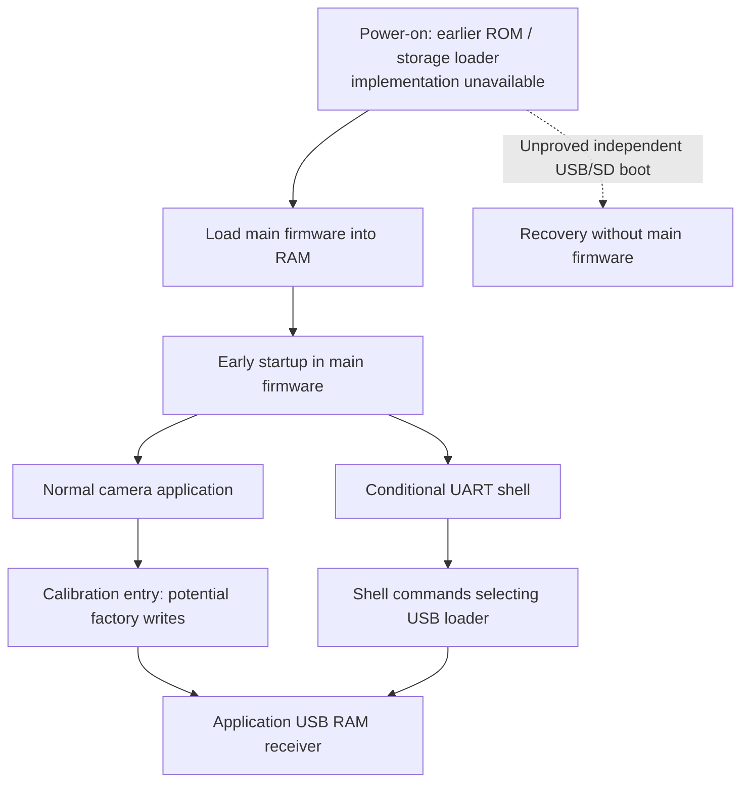

# Recovery entry review: application startup and eSD firmware slots

Date: 2026-11-01. Offline static analysis only. The user had the camera connected
and powered on, but this investigation did not access it. Target: official 2.00
`firmware-main.bin`, SHA-256
`80350bd2bc37b4ce985742ff85a747f7c7ad1ed9be401534ba57ac3262f1d923`,
ARMv7 little endian, runtime base `0x40000000`.

## Result

Two leads were followed beyond the earlier reports:

- An early startup branch bypasses the normal camera application and starts
  the command shell. Its selector depends on hardware/power-source and saved
  RTC state. This is still code inside the main firmware, and the shell input
  path is UART; no retail USB activation or physical button recipe was found.
- The state consumed by `sdboot` comes from the vendor's eSD reserved-storage
  header. We can now identify its allocation, raw-sector read, signature/type
  checks, and firmware-slot fields. This does not establish that mask ROM reads
  a removable SD card with this format, or that it selects a fallback slot.

Neither lead currently provides a safe RAM-boot procedure or independent
recovery. The normal USB endpoint observation is useful transport preparation,
but it does not resolve either of these entry conditions.

Follow-up: [early USB startup dependencies](early-usb-startup-dependencies.md)
shows that the early-shell branch skips the normal routine containing loader
callback registration. Original dispatcher controls with a supplied empty
table reach a null-initializer assertion, not automatic fallback registration.
Actual early-shell table contents and optional task behavior remain unknown.

Further [four-version selector comparison](early-boot-selectors-across-versions.md)
finds that 1.30/2.00 add a saved-word `0x6000` rejection absent from 1.01/1.20,
and 2.00 moves an auxiliary success flag. A selected earlier reset guard is
unchanged across releases. Original ARM controls qualify these bounded
decisions, without identifying a physical key sequence or USB recovery entry.



The solid main-image paths above are static findings; external boot-stage
loading is the required context, not recovered boot-ROM code. No path in this
diagram has been used to RAM-boot this camera.

## Early shell branch

The image's first instruction branches from `0x40000000` to `0x40000ec0`.
That entry is part of the loaded main image, not evidence that we possess the
CPU's immutable reset ROM. Existing startup analysis remains applicable.

`0x400037e8` performs low-level setup and calls `0x4001d0dc` at `0x400039ac`.
It stores return bit 0 in the runtime byte `0x40e38074` at `0x400039bc`.
Later, `0x40003498` tests that byte at `0x400035fc..0x40003608`:

```text
nonzero -> 0x401efc90 (cmdTaskInit), then a common startup tail
zero    -> normal initialization, including 0x400f86f4 at 0x40003700
```

The nonzero branch is earlier than the ordinary camera application, but it
still relies on the main image, OS initialization and shell implementation.
It must not be described as a boot-ROM USB loader or recovery that survives
arbitrary corruption of the installed application image.

The selector `0x4001d0dc`:

1. Clears state byte `0x40e4ae68` and calls `0x40041ca4` with destination
   `0x40e4ae64`.
2. That helper reads a record through `0x4006b4d4`, checks its first four bytes
   against a byte-sum field, and reconstructs a word if valid. Its read path
   reaches `0x40028584`; this is the existing RTC-backed state family, not
   `COLDDATA.BIN`.
3. Obtains the power-source word through `0x4001d880`. The preceding startup
   call `0x4001d89c` constructs it from helpers `0x400470c0`, `0x40047160`,
   `0x400471c4` and MMIO byte `0x10001304`, storing it at `0x40e4aeac`.
4. Combines power-source bits `0x01000000` and `0x00008000`, bit 0 of MMIO
   `0x1000517a`, and saved-word masks `0x00000003`, `0x00000800`, and
   `0x00006000`. On success it sets runtime state bytes and returns 1.

The masks above describe operands, not a complete Boolean replacement for the
branching code. No physical names are assigned to the MMIO bits. The return
status from the saved-record read is not checked by the caller; no claim is
made about the selector's result on an invalid or unreadable RTC record.

The only aligned direct ARM call found for `0x4001d0dc` is `0x400039ac`.
The earlier [shell audit](shell-access-and-usb-lifecycle.md) established UART
input; the USB character bridge requires target 0 already selected. This branch
does not by itself break that circular requirement. The user's no-disassembly
constraint rules out pursuing a UART wiring experiment.

## Where `sdboot` gets its firmware layout

The previously unexplained pointer at `0x40e4e564` is an alias of storage state
`0x40e4e3e0 + 0x184`. In the routine named `sdDetect` by its diagnostic strings
(`0x4004e9dc`, source string `libsd/sd_core.c`), the argument-1 path allocates
512 bytes at `0x4004eac0..0x4004eacc` and stores that pointer there.

The raw-header read at `0x40050038..0x40050058` uses:

```text
sector = (read16(0x10004054) & 1) ? 0x40 : 0
sector count = 1
destination = *(0x40e4e564)
read helper = 0x4004ddb0
```

`0x40057dcc` is the getter for that MMIO halfword. Its bit meaning and which
physical storage it selects are not established here. The read's error test
compares its return against 1; this report does not reinterpret it as a generic
Boolean or full byte-count contract for all storage paths.

The following code checks little-endian halfword `+0x08 == 0xbeef` and byte
`+0x40 == 0x32`. On mismatch it logs `eSD header fail`, clears the reserved and
firmware block-count fields, and supplies a default block size `0x8000`.
That is storage-layout handling in an executing driver, not a demonstrated
cold-boot decision.

The field names below are supported by the diagnostic printer in
`0x40077450`, not invented symbol names:

| Header offset | Width | Meaning / evidence |
| --- | --- | --- |
| `0x00` | 8 bytes | `asciiName`; builder uses `eSD RSV` |
| `0x08` | 16 bits | `signature`, checked as `0xbeef` |
| `0x0c` | 32 bits | `blkSize`, bytes per layout block |
| `0x14` / `0x18` | 32 bits each | Start block for firmware slot 1 / 2, as consumed by `0x400778fc` |
| `0x1c` / `0x20` | 32 bits each | Firmware lengths in bytes, associated with slots by consumers/setters |
| `0x24` | 32 bits | `tolblk`, total layout blocks |
| `0x28` | 32 bits | `nrHdr` |
| `0x2c` / `0x30` / `0x34` | 32 bits each | `nrRsvA`, `nrRsvB`, `nrRsvC` |
| `0x38` / `0x3c` | 32 bits each | `nrFw1`, `nrFw2` |
| `0x40` | byte | Type/version byte checked as `0x32`; full halfword also used by header writer |
| `0x42` / `0x44` | 16 bits each | Slot-1 integrity fields, consistent with updater report |
| `0x46` / `0x48` | 16 bits each | Slot-2 integrity fields, consistent with updater report |

This is a partial schema, not an image-construction specification. Full header
integrity, DRAM data, units for other consumers, and early-boot interpretation
remain unresolved. The schema must not be used to format a recovery card.

`0x400778fc` reads from the selected slot's start block multiplied by
`blkSize / 512`, plus the supplied byte offset divided by 512. Its slot selector
is argument 2. The `sdboot` worker at `0x40345c80` explicitly sets that argument
to zero and uses slot-1 length `+0x1c`; the existing advertised embedded/external
argument does not reach this selector as its help suggests.

The same worker retains its original first argument as both destination and
execution address, and branches there even when the read helper returns an
error. See [the original instruction trace](ram-boot-entrypoints.md). This is
another reason not to treat `sdboot` as a ready recovery command.

### Nearby layout functions write storage

`0x40077450` is not just an inspector: after constructing a replacement header,
it calls `0x4008b2a8` twice. That routine checks `0xbeef`, constructs integrity
fields, and reaches the storage-write helper `0x40050e48`. Its caller logs
`Write Header%u Fail`. Another layout routine at `0x40077114` moves disk data
using both read `0x4004ddb0` and write `0x40050e48`.

Thus invoking a vendor routine because its name mentions SD/header inspection
could modify reserved storage. None was invoked on the camera. The source-path
string `libsd/sd_isp.c` and `eSD` terminology alone do not identify the X-half
physical storage topology or a removable-card boot contract.

## Implications and next work

| Route | Main image required by observed code? | Current implication |
| --- | --- | --- |
| `clbt usb` / `usbt` | Yes | Potential RAM-experiment entry, shell access unresolved |
| Calibration startup to mode 4 | Yes | Entry candidate exists, automatic calibration writes remain a barrier |
| Early command-shell branch | Yes | Bypasses ordinary app startup, but no accessible USB entry shown |
| Diagnostic `sdboot` | Yes | Reads firmware slot through running storage driver; unsafe handoff behavior |
| Firmware1 → Firmware2 fallback | Selector not recovered | Transactional update evidence remains strong, cold-boot selection unproved |
| Mask-ROM SD/USB boot | Code not available | Independent recovery still unproved |

For temporary RAM experiments, the next bounded question is whether a
retail-reachable callback can select USB target 0 without entering calibration.
This requires tracing exact mode setters/dispatchers rather than sending vendor
requests to the normal PTP interface. For independent recovery, the decisive
missing evidence remains the stage that loads this main image: an exact-body
boot-stage artifact, documented boot contract, or observed boot log/ROM dump.
No proposed test should deliberately damage Firmware1 to discover fallback.

Reading cold-data flags remains an optional way to qualify calibration entry,
not a prerequisite for all further research and not itself recovery. No live
operation is justified by the SD header schema or early shell branch alone.

## Reproduction

Original-byte disassembly via `analysis/fw.py disasm`, runtime ranges with
exclusive end:

```text
40000000..40000004   main-image vector branch
400037e8..40003b84   early startup and selector store
40003498..400037a0   shell-versus-normal startup branch
4001d0dc..4001d1bc   selector and literals
4001d854..4001d8f0   power-source construction/getter
40041ca4..40041d0c   saved-record checksum/read
4006b4d4..4006b594   RTC-family wrapper
4004eaac..4004eaf4   512-byte state allocation
40050038..4005013c   raw header read, check and fallback layout
40057dcc..40057ddc   MMIO getter
40077450..4007781c   layout constructor/printer and write callers
4008b2a8..4008b3e8   header integrity/write helper
400778fc..40077980   firmware slot reader
40345c80..40345cd4   sdboot worker
```

Focused pseudocode was exported using the existing Ghidra 12.1.4 ARMv7 project
and `QueryFirmware.java`, followed by `DecompileTargets.java` for verified
entries `4001d0dc`, `4008b3e8`, `400778fc`, `40050748`, `4004e9dc`.
Local exports: `/private/tmp/recovery-entry-review.txt` and
`/private/tmp/recovery-entry-functions.txt`. Several driver functions were
missing function definitions in the existing database; the explicit-entry
script supplied analysis metadata only. Privileged startup pseudocode has
unresolved instruction warnings; original ARM bytes take precedence.
The local project was used because of the previously recorded REA raw-import
base-mapping failure. No new REA result or runtime execution is claimed.
