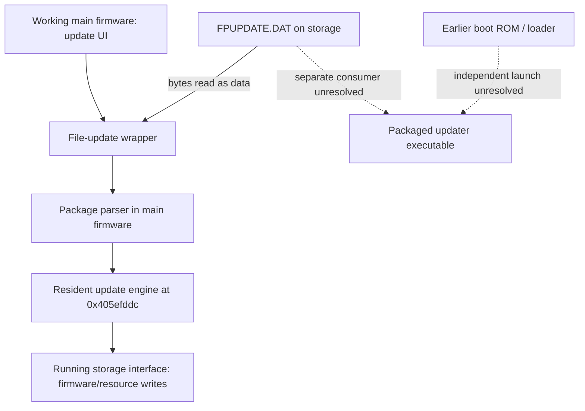

# Normal file update calls the resident update engine

Date: 2026-11-02. Offline original-byte inspection and ARM emulation of official
2.00 main firmware and package. No camera access, USB requests, card writes,
firmware execution on hardware or flash operations.

## Finding

The inspected normal file-update path **does not hand control to the updater
executable carried at package offset `0x200` before reaching the update engine**.
It reads the package into ordinary allocated buffers, parses its headers, and
calls updater-library routine `0x405efddc` already inside the main firmware.

This corrects the premise of the previous next-step question: there is no
packaged-executable launch to explain at this point in the normal path. The
presence of that executable in `FPUPDATE.DAT` still does not establish a cold
SD recovery entry. Its other consumers remain a separate question.

Static continuation identifies the resident engine's checksum pass and
Firmware1 writer calls through the running storage interface. The five new
offline controls stop **before** entering that engine. They do not validate
its full call tree, storage effects, power-loss behavior, or every later
indirect call.



Solid arrows are code-path findings, not observed camera execution. The new
emulator stops at entry to E; W is inspected statically and not executed.

## Call chain and coordinates

All function addresses below are in `firmware-main.bin`, base `0x40000000`:

| Location | Relevant behavior |
| --- | --- |
| Update UI `0x40485d00` | Existing trace configures update options and calls the adapter |
| Adapter `0x405ade18` | Stores initialization marker `0x5a`, stages pathname and tail-calls `0x405f9b04` |
| `0x405f9b04` | Checks marker at `0x413e4ac0`, validates the pathname's drive through `0x40011478`, calls `0x405f9794` |
| `0x405f9794` | Opens the file with flags `0x10`, obtains its size and allocates a read buffer |
| `0x405f988c` | Calls read helper `0x400102d4`; a short initial read takes cleanup/error path |
| `0x405f9a90` | Calls actual package parser `0x405f8fdc` |
| `0x405f99ec..0x405f99f8` | Passes package-buffer pointer in `r0`, parser state in `r1`; calls literal target **`0x405efddc`** |
| Literal `0x405f9af8` | Contains `0x405efddc`, a resident code address rather than a buffer-derived entry |

The separate memory-input wrapper also calls the same resident engine at
`0x405f95d8` through literal `0x405f966c`. This is corroborating static evidence,
not an additional executed emulator scenario.

In the inspected file path, the parser validates `SUNP BURN FILE`, `HDR 1`,
`HDR 2` and `HDR 3` structures and builds metadata. Its copy/compare operations
treat the package contents as data. The first package-buffer bytes are the
outer header; `buffer + 0x200` contains the packaged updater reset branch.
Execution does not move into that buffer before the resident-engine call.

The wrapper probes a 2 MiB allocation, then tries to allocate a file-sized
buffer. On failure, it halves and aligns the requested size until allocation
succeeds or falls to roughly 1 MiB. Thus a partial file window is supported;
it does not necessarily read the whole 165 MB package into RAM at once.

When HDR3 lies beyond the initial window, the parser seeks and reads its
metadata separately. Seek helper `0x400103b8` uses a 64-bit offset aligned in
`r2:r3`, with origin on the stack; `r1` is padding. Treating this call as a
three-argument 32-bit seek gives an incorrect emulator model.

The file path also uses byte `0x40e15398` as a drive-selection value. The new
controls supply `'?'` (`0x3f`) initially, allowing explicit pathname `D:` to set
it to `'D'` through original getter/setter `0x405f19e0`/`0x405f19f0`.
That is a RAM byte change, not an SD marker or a persistent setting write.
Other drive-selection branches and the outer UI wrapper are not emulated.

## Static continuation into the resident engine

Engine entry `0x405efddc` loops over the declared package length at parser
state `+0x10`, calls checksum helper `0x40057d68`, and refills windows through
`0x405ef114` as needed. A bad sum returns error 9. Valid-sum continuation
`0x405f1990` invokes configuration helpers and obtains the storage interface
through `0x40021c7c(1)` at `0x405eff28`.

The Firmware1 branch calls resident writer `0x405ef18c(0, buffer, state, ...)`.
That writer takes the main payload offset from state `+0x1c`, not the packaged
updater's entry. At `0x405ef27c..0x405ef290` it calls the storage interface's
`+0x60` operation with selector 2, and at `0x405ef398..0x405ef3bc` it calls
that interface with selector 6 and the current payload chunk. This is storage
update orchestration inside the running main application.

These observations establish the resident update mechanism. They are not a
claim that every optional branch avoids code relocation, that hardware never
runs another processor, or that no earlier boot mechanism can launch the
packaged updater. The complete engine and its dynamic callbacks are not
qualified as read-only or safe to invoke.

## Original-code controls with official package bytes

[`ReproduceUpdaterFilePath.java`](scripts/ReproduceUpdaterFilePath.java)
validates both artifact hashes, then runs original file-wrapper instructions,
the actual package parser, its cleanup function, byte-comparison/string-length
helpers, and RAM drive getter/setter. Unexpected execution fails the run.

Two allocator policies cap individual allocations at 2 MiB or 4 MiB, causing
the original buffer-halving loop to choose these windows:

| Allocation cap | Initial package read | Further metadata reads | Stop boundary |
| --- | --- | --- | --- |
| `0x200000` | Offset 0, `0x138000` bytes | HDR3 at `0x09e1c120`, lengths `0x20` and `0xaa0` | `0x405efddc` |
| `0x400000` | Offset 0, `0x278000` bytes | Same HDR3 reads | `0x405efddc` |

Both runs assert the call arguments, original reset branch at buffer `+0x200`,
Firmware1 payload offset `0x08fe3d20` in parser state, retained file descriptor,
and **Firmware2-enable state `+0x234 == 0`**. The latter now has additional
actual-parser evidence for the official package rather than only a structure
initialization argument.

Three failure controls supply an open failure, an initial read one byte short,
or a corrupted HDR1 marker in the modeled read buffer. All return `0xfffffffe`
without reaching the resident engine, closing the file when it was opened.
The official on-disk package is unchanged; corruption exists only in emulated
read data. **All five controls pass.**

File I/O, allocation policy, memory copy/zero, string comparison, formatting and
logging are modeled. They use host bytes as data and never open camera storage.
Successful paths preserve all bytes of the loaded main-image range except the
explicit drive byte; parser state, stack and data buffers occupy separate
synthetic addresses. This is not a full runtime memory snapshot or hardware
allocator model. No packaged instruction, resident update-engine instruction,
checksum pass, storage callback, flash writer or RTC operation executes.

Hashes:

- Main: `80350bd2bc37b4ce985742ff85a747f7c7ad1ed9be401534ba57ac3262f1d923`
- Package: `3c1c662957003e5bab4f2a8fcb184180d72a92dbdec4fbeea030dac0df755d68`

Output: [`output/updater-file-path.txt`](output/updater-file-path.txt).

```sh
GHIDRA_PROJECT_DIR=/private/tmp/fuji-ghidra-v7 GHIDRA_PROJECT_NAME=FujiV7 \
  bash analysis/run-ghidra.sh -process firmware-main.bin -noanalysis \
  -postScript ReproduceUpdaterFilePath.java /private/tmp/updater-file-path.txt \
  "$PWD/FPUPDATE.DAT"
```

Static checks use `analysis/fw.py disasm`/`literals` at the ranges above.
Focused local Ghidra export: `/private/tmp/updater-file-launch.txt`. This reuses
the documented local-project fallback; no new REA or live evidence is claimed.

## Implication for bricking risk

The normal menu-driven update depends on the working installed main firmware
to open the file, parse it and enter the resident engine. Having a complete
updater executable on the card does not prove that the camera will find and
run it after that main firmware is damaged.

The missing evidence is a separate earlier-stage consumer: who can load the
packaged executable without the normal application, with which boot conditions
and DRAM setup. No independent recovery entry or new camera experiment follows
from this file-update trace.
