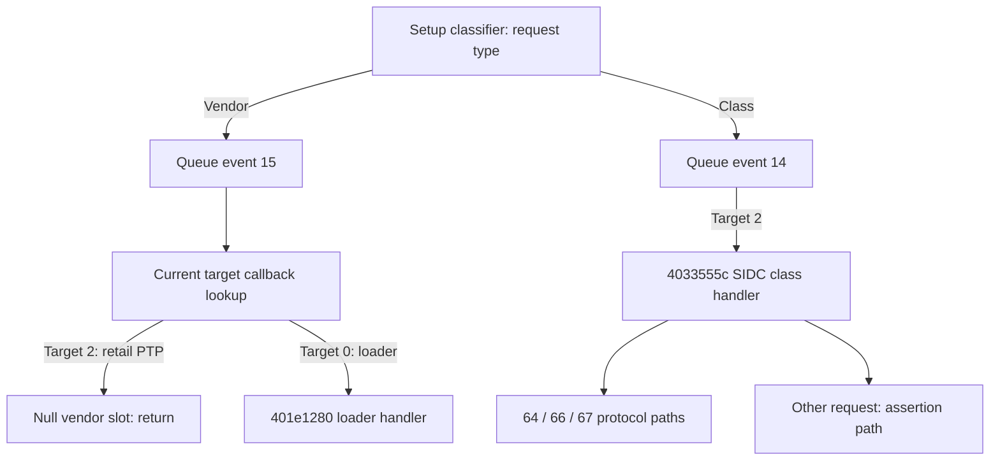

# Retail USB control routing and class-reset boundary

Date: 2026-11-01. Offline original-image analysis and ARM emulation only.
No camera, host USB, card marker, firmware change or live request was used.
Official 2.00 main-image SHA-256:
`80350bd2bc37b4ce985742ff85a747f7c7ad1ed9be401534ba57ac3262f1d923`.
ARMv7 little-endian, base `0x40000000`.

## Result

On the inspected normal setup-request path, retail PTP mode has **no vendor
control callback**. It does not fall back to the loader's callback. Both
registrations can coexist in RAM, but current target selection determines
which callback is used. Six retail vendor-request controls return through
the null slot; six loader-target controls reach the loader-entry boundary.

The registered retail class handler accepts request numbers `0x64`, `0x66`
and `0x67`. Its `0x66` reset branch clears protocol/session RAM and reaches
a USB-controller MMIO helper. It does not reach the cached USB-selection
refresh before that boundary. This USB class reset is distinct from the
unsupported **PTP bulk operation** reset codes in the
[preceding investigation](retail-ptp-command-boundaries.md).

There is also a concrete hang hazard: unknown class requests reaching this
handler call an assertion routine that writes a USB register, logs, invokes
another helper, and then spins indefinitely if that helper returns. This is
static evidence of a possible runtime hang, not an observed permanent brick.

All 16 offline controls passed. No safe loader entry or independent recovery
path is established by these results.

## Mode mapping and original registration

`0x4038d6d0` maps API modes through bytes at `0x40b74837`:

```text
API mode 3 (ordinary PTP) -> internal target 2
API mode 4 (RAM loader)  -> internal target 0
```

Mode and target numbers are different namespaces. Setter `0x401b9fcc`
stores the current target byte at `0x40fc7b8c`. Its one found aligned direct
caller is `0x4038d738` in the API wrapper. No exact entry pointer was found.
These are bounded searches, not proof that the target byte has no other writer.

Registration function `0x401ba258` stores callbacks in arrays rooted at
`0x40fc7b78` (`T`), with each slot indexed by `4 * target`:

| Array offset | Meaning established by this trace | Target 0 registration | Target 2 registration |
| --- | --- | --- | --- |
| `+0` | Personality initializer | `0x401e122c` | `0x402e4f80` |
| `+0x2c` | Other protocol/event handling | 0 | `0x402e5d78` |
| `+0x40` | Class setup-request handler | 0 | `0x4033555c` |
| `+0x54` | Vendor setup-request handler | `0x401e1280` | **0** |

Loader registration `0x401e2104` passes target 0; PTP registration
`0x402e6314` passes target 2. PTP removal/teardown `0x402e64b0` calls the
same registrar with target 2 and all callback arguments zero. None of these
operations installs the loader in target 2's vendor slot.

The registrar has six whole-image exact-pointer hits, at `0x401bd050`,
`0x401e2140`, `0x402e0e8c`, `0x402e0f6c`, `0x402e6364`, `0x402e652c`.
They belong to target registrations 3, 0, 1, 4, 2 and target-2 removal,
respectively. Aligned direct ARM calls were absent because these sites call
through literal-loaded registers. Computed pointers, bulk table updates,
other instruction sets and external stages remain outside the census.

Raw search results: [usb-control-registration-callers.txt](output/usb-control-registration-callers.txt).

## Setup classification, queue copy and target dispatch

Common request handler `0x401e941c` masks setup byte 0 with `0x60`:

- Type `0x20` calls class wrapper `0x401b9ae8`.
- Type `0x40` calls vendor wrapper `0x401b9b3c`.
- Standard requests take a separate branch, including descriptor lookup for
  request 6. Other/reserved types reach error handling. These branches were
  inspected statically but are not exercised by the new controls.

Each class/vendor wrapper obtains an 8-byte payload object, copies the entire
setup packet, sets an internal event number (14 for class, 15 for vendor),
and queues it through `0x401e0090(1, message)`. The event number comes from
the wrapper, not a packet value/index field.

Task `0x401ba2b8` obtains queue messages, calls dispatcher `0x401ba030`, then
releases them. Dispatcher event 14 reads `T + 4*target + 0x40`; event 15
reads `T + 4*target + 0x54`. At `0x401ba130`, a null callback returns.
There is no fallback to target 0. Non-null callbacks receive the payload
pointer and the message's second argument.



This traces the normal common setup classifier and queue consumer. It does
not exhaustively audit controller ISR preprocessing, every standard request,
or every possible alternate installation path.

## Class handler and reset effects

`0x4033555c` identifies itself with `[usbSIDCClassReq]` and source string
`sidc/usb_sidc_class_req.c`.

| Request byte | Inspected path | New execution boundary |
| --- | --- | --- |
| `0x64` | Calls `0x4005714c(0)`, receives the setup-declared length through `0x401e0ea0`, then calls cancellation helper `0x402e62a0` | Before first helper `0x4005714c` |
| `0x66` | Zero-length status transfer, then reset helper `0x402e62d8` | Before MMIO helper `0x400560a0(3,1)` |
| `0x67` | Reads busy flag `0x401dfccc`; encodes response `0x2001` or `0x201f`, with additional busy-path work | Before first status-encoding helper `0x401cafa0`, with busy flag supplied zero |
| Other, tested with `0xfd` | Calls `0x401bd278` with `T.B.D`, source path and line number | Before assertion executes |

Reset helper `0x402e62d8` sets protocol-state byte `0x40df78ec` to 2,
clears session word `0x4136b674`, then calls `0x401e1010(3,1)`.
That wrapper forwards to `0x400560a0`, which accesses USB MMIO base
`0x10005000`. Its argument-3 branch uses mask `0x10`, offsets `+0x310`,
`+8`, `+0x300`, and helper `0x4000c30c`. This is not a call to the main
startup handler, `DPC`, or a CPU-reset routine in the inspected branch.
Later asynchronous effects and actual hardware behavior remain unqualified.

Unknown-request assertion `0x401bd278..0x401bd2c4` clears byte
`0x10005008`, prints `ASSERT=>`, calls `0x40021a08`, and has a self-branch
at `0x401bd2b0`. The lower helper, watchdog behavior, power-cycle recovery,
and full hardware consequences have not been tested. We stop before this
routine: no assertion or MMIO write was executed in the emulator. The finding
is a reason not to treat arbitrary class-request probing as a harmless
way of discovering hidden commands.

## Original-code controls and limitations

[ReproduceRetailUsbControl.java](scripts/ReproduceRetailUsbControl.java)
verifies the main-image hash, executes both original registration functions,
checks their exact callback slots, and then supplies the selected target byte.
It does **not** execute personality initializers or a real mode switch.

The test runs original classification, 8-byte setup copying, and target
dispatch. Allocation and enqueue are modeled; delivery from the producer
queue to the consumer is supplied explicitly. Thus this is a composition of
the original queue boundaries, not a successful live transfer or scheduler test.

- Twelve vendor controls: requests `0x70`, `0xfa`, `0xfd`, both IN/OUT type
  encodings (`0xc0`/`0x40`), and targets 2/0. All target-2 cases return through
  the null slot. All target-0 cases stop before `0x401e1280` executes. These
  controls prove routing, not that every direction/request pair is supported
  by the loader. Image/global RAM remains unchanged after supplied fixtures.
- Four target-2 class controls: `0x64`, `0x66`, `0x67`, `0xfd`. The reset
  case models only its zero-length status transfer and executes the original
  protocol/session updates before stopping at the MMIO helper. Other controls
  stop at the boundaries above. The busy flag for `0x67` is supplied zero.

Every case compares image/global RAM `0x40000000..0x413fffff` with the exact
expected result. Only the reset case permits two changes: protocol-state
byte and session word. The selected target, cached USB-selection flag and
entire staged cold-data fixture remain unchanged. Synthetic stack/message/
payload/packet storage is separate. No loader, shell, RTC/file operation,
real allocator/queue, hardware operation or actual USB response was executed.

Retained results: [retail-usb-control.txt](output/retail-usb-control.txt).

```sh
GHIDRA_PROJECT_DIR=/private/tmp/fuji-ghidra-v7 GHIDRA_PROJECT_NAME=FujiV7 \
  bash analysis/run-ghidra.sh -process firmware-main.bin -noanalysis \
  -postScript ReproduceRetailUsbControl.java /private/tmp/retail-usb-control.txt

python3 analysis/fw.py disasm 0x402e6314 0x402e6368
python3 analysis/fw.py disasm 0x401ba258 0x401ba294
python3 analysis/fw.py disasm 0x401e941c 0x401e957c
python3 analysis/fw.py disasm 0x401b9ae8 0x401b9b90
python3 analysis/fw.py disasm 0x401ba030 0x401ba144
python3 analysis/fw.py disasm 0x4033555c 0x403356d0
python3 analysis/fw.py disasm 0x402e62d8 0x402e6314
python3 analysis/fw.py disasm 0x401bd278 0x401bd2c4
```

Existing local Ghidra ARMv7 analysis and original-file disassembly were reused
after the documented REA raw-image mapping limitation. No fresh REA runtime
or device evidence is claimed. The main open problem remains an actual way
to select loader target 0 without unqualified saved-state changes; sending
its request bytes while target 2 is selected does not resolve that problem.
