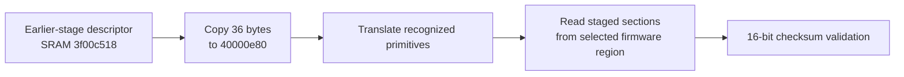

# Staged loader storage callbacks and earlier-stage handoff

Date: 2026-11-02. Entirely offline; camera unplugged. No device connection,
storage operation, firmware patch, factory-data change or boot experiment.

## Finding

The staged application loader's storage callbacks are now identified. They
use a 36-byte descriptor copied from earlier-stage SRAM, translate a small
set of recognized low-address primitive pointers into application-side NAND
functions, load sections of the selected firmware region, and validate
16-bit additive checksums.

This is evidence of a concrete **earlier-stage handoff contract**. It is not
a recovery-entry sequence, a recovered ROM image or evidence that a retail
camera accepts host-supplied pointers. The source descriptor, its producer,
and the physical backing of the low addresses remain unrecovered.

A second result closes the gap before the staged hardware fills: the
loader-facing main entry contains a CPU zeroing loop for
`[0x40e37c00,0x40e68880)`, after copying its SRAM code. This complements the
five later hardware-fill requests ending at `0x414fb780`.

## Identity and methods

Official 2.00 main image, ARMv7 little-endian at `0x40000000`, SHA-256
`80350bd2bc37b4ce985742ff85a747f7c7ad1ed9be401534ba57ac3262f1d923`.
Local Ghidra 12.1.4, original ARM disassembly and bounded original-instruction
controls were used. No fresh REA or device runtime execution is claimed.

Evidence:
[handoff profile](output/loader-storage-handoff.json),
[callback pseudocode](output/loader-storage-callbacks.txt),
[original ARM boundaries](output/loader-storage-boundaries.txt),
[16 control results](output/loader-storage-controls.txt).

## Descriptor provenance and callback installation

On the inspected loader-facing path, `0x40000878` copies:

- 512 bytes from SRAM `0x3f000000` to main-image workspace `0x40000c80`.
- **36 bytes from `0x3f00c518` to `0x40000e80`**, via the call at `0x4000089c`.

The second descriptor includes a size/geometry value at `+0x18` and primitive
pointers at `+0x1c` and `+0x20`. Those source bytes are not contained in the
supplied main image as an observed live descriptor.

Later in that entry, `0x40000740` calls installer `0x40000918`. It fills the
worker callback table at `0x40000bc0`:

| Offset | Installed function | Inspected role |
| --- | --- | --- |
| `00` | `40029dbc` | Registers two application notifications under interrupt exclusion; used by `4000f550` with supplied callbacks |
| `04` | `40029314` | Replaces recognized earlier-stage primitives and adjusts controller-related state |
| `08` | `40029e04` | Staged section acquisition/checksum accumulation using RAM-resident data or selected NAND primitive |
| `0c` | `4002a174` | Stage/final checksum comparison |

The worker calls `+04` before loading, `+08` through `0x4000efe4`, and `+0c`
for stage and final validation. `+00` is a notification-registration API,
not a storage reader. `0x400035bc` forwards callbacks `0x4001d424` and
`0x4001d428` through it during application initialization. Those addresses
are branch thunks; their decompiled signatures are not original source names.

## Recognized low-address primitive values

Function `0x40029314` translates the descriptor's pointer slots as follows:

| Descriptor slot | Recognized value | Replacement in 2.00 main image |
| --- | --- | --- |
| `+1c` | `00003cd0` | `40028dc4` |
| `+1c` | `00004aac` | `400299d0` |
| `+1c` | `00004654` | `40029578` |
| `+20` | `000037e8` | `400294f0` |
| `+20` | `00003a30` | `40029468` |
| `+20` | `0000421c` | `40029b9c` |

Unrecognized values take the diagnostic/assertion path in this initializer.
The literal source path `multiboot/multiboot_nand.c` and controller accesses
support the NAND interpretation. Multiple compiled implementations do not
identify which NAND part or primitive pair is populated on the camera.
These are **application-recognized earlier-stage addresses**, not recovered
code or verified immutable-ROM addresses. They also do not identify the
implementation of the separate low helper `0x00000b34`.



This is the inspected software relationship, not an observed boot or a
host-facing interface.

## Read and validation boundaries

`0x40029e04(start_sector,count)` treats its arguments as sector positions and
counts. For an initial already-resident range, it computes a checksum directly
from main RAM through `0x40057d40`. That helper sums bytes and returns the
low 16 bits. For the remainder, the callback reads `0x10004054` through
`0x40057dcc`; bit 1 chooses between firmware-region metadata fields. It
computes the storage position, accounts for block/bad-block information and
calls the descriptor's selected `+1c` primitive. Destination addresses are
derived as `0x40000000 + sector*512`, not supplied through a retail PTP API.

This pass did not execute storage primitives, establish actual descriptor
contents, or audit every NAND helper. No automatic bank-switch/recovery path
was established by the inspected callback's failure branch, which logs
`FW%d fail` and returns through checksum state handling. A diagnostic naming
two firmware regions is not independent fallback evidence.

Validator `0x4002a174` uses a current accumulator at `0x40000c00` and total
accumulator at `0x40000c40`:

- An ordinary stage comparison reads the low 16 bits of the current
  accumulator, clears the current word, and compares against the expected
  argument.
- Expected value `0x88888888` is accepted by this comparison even on mismatch.
  This is a local callback sentinel behavior, not a patch recommendation.
- Input `0xffffffff` selects final validation: boot-status bit 1 chooses the
  expected halfword at `0x40000cc4` or `0x40000cc8`, compared against the total
  accumulator's low 16 bits. This branch does not clear the current word.
- A mismatch logs an error and returns 1; acceptance returns 0. The stage
  worker has its own failure handling around that result.

These are **staged-load checksum semantics**, separate from the DAT package's
word checksum and other update validation. They do not prove that the full
update process lacks authentication or that modified firmware is accepted.

## Early CPU clear preceding the hardware fills

At `0x40000684..0x400006c4`, the loader-facing entry reads table words at
`0x40000b1c` (`00e37c00`) and `0x40000b2c` (`00e68858`). It rounds the upper
bound to 64 bytes, adds the CPU base and stores zero in 16-byte steps.

This clears `[40e37c00,40e68880)`, length `0x30c80`, before continuing to
`0x40000724`. Together with the later table-derived requests, the intended
zero-initialization coverage is contiguous through `0x414fb780` on the
inspected successful loading path. The early part overlaps the file's last
bytes: SRAM code has already been copied out of the source at `0x40e37c00`.
Thus file-backed bytes and runtime static-storage lifetime are different
concepts here.

This CPU loop is conditional on reaching that loader-facing path. The reset
vector alone does not establish that it has run. A future RAM payload still
needs a qualified entry and descriptor/hardware state; these findings do not
make a jump to either the reset vector or `+0x200` a validated RAM-boot recipe.

## Controls and limits

[InspectLoaderStorageBoundaries.java](scripts/InspectLoaderStorageBoundaries.java)
checks the image hash and executes original instructions in selected ranges:

- One early-clear control, starting after earlier code-copy work, verifies all
  `0x30c80` bytes become zero with neighboring guards and the later PTP callback
  sentinel unchanged. It stops before `0x40000724` and storage-register actions.
- Nine descriptor fixtures cover all three recognized values in each pointer
  slot, stopping before the initializer's MMIO branch at `0x400293c8`.
- Six checksum controls cover match, mismatch, the acceptance sentinel and
  both final-region selections. Only logging is modeled; the status-register
  read is served by an explicitly supplied emulator memory fixture.

All 16 passed. No actual MMIO, NAND operation, low-address provider, DMA or
complete boot executes. The fixtures do not identify the production camera's
descriptor or prove a firmware recovery path.

```sh
GHIDRA_PROJECT_DIR=/private/tmp/fuji-ghidra-v7 GHIDRA_PROJECT_NAME=FujiV7 \
  bash analysis/run-ghidra.sh -process firmware-main.bin -noanalysis -readOnly \
  -postScript InspectLoaderStorageBoundaries.java /private/tmp/loader-storage-controls.txt
```

The next remaining boundary is the earlier stage that produces this descriptor
and chooses how the main image is entered. Its bytes and external recovery
selectors are still unavailable; this application-side contract cannot supply
them by itself. No camera connection is required for the findings above.

Follow-up: [updater selection and descriptor search](updater-firmware-selection.md)
ties named FW1/FW2 selections to status bit 1 in the running updater. Bounded
store searches of both images found no resolved producer of the SRAM descriptor;
their scope and missed-writer limits are recorded there. This does not prove
the producer is absent or identify the cold-start selection policy.
