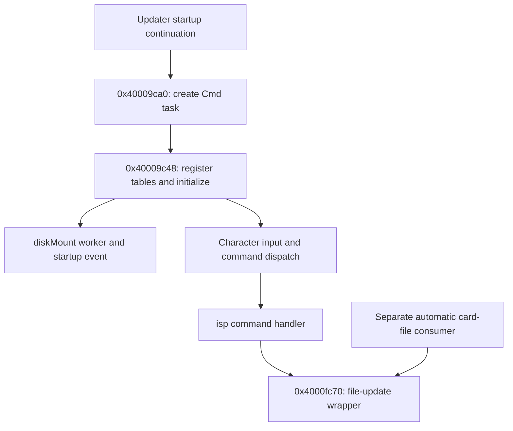

# The updater's startup task is a command interpreter

Date: 2026-11-03. Offline static inspection of official 2.00 complete updater,
base `0x40000000`, SHA-256
`4bdcdb060c89dcaa18b77d9d7b5f1a4e337627137f0b7c8d9a79a9dcf4048976`.
All routine addresses in this report belong to that updater. No camera access,
command execution, card preparation or firmware changes.

## Finding and correction

Setup function `0x40009ca0`, previously labeled **ISP task/setup**, creates a
task whose actual name is `Cmd` and entry is `0x40009c48`. Its diagnostics name
`private/cmd_parse.c`, and its default prompt is `cmd>`. The task registers
command tables, initializes a storage worker, and enters a character-input/
command-dispatch loop. Task creation itself is not an automatic flash request.

The previous label was misleading and is corrected in current reports and
the mailbox harness's output wording. Historical control logs retain their
old boundary name; the numerical stop address remains valid.

This narrows the RAM-launch risk assessment; it does not establish write-free
startup. The outer boot consumer can invoke a card-file updater before this
task runs, and the task exposes actual update/write/erase commands. Its
storage worker and all concurrent initialization effects are not fully audited.

These are static call edges. No task, command or update engine ran on hardware.

## Task setup, initialization and dispatch

Setup `0x40009ca0` passes literal name `Cmd` at `0x400954ef` and entry
`0x40009c48` to task creation `0x40082474`. It can also start auxiliary
console service `0x4000908c`, depending on configuration byte `0x4009d6b0`.
It registers callback `0x40009abc` through `0x4001d05c`; that setter merely
stores the callback at `0x400a3a80` in the inspected slice.

The command task:

1. Registers the built-in `help`, `ver`, and `hwver` table at `0x4009d6c0`.
2. Calls initializer `0x40001150`.
3. Installs three framework callbacks through `0x4007ec64`; their full runtime
   role is not assigned here.
4. Repeatedly calls `0x40009b0c` to obtain and dispatch input.

`0x40009b0c` calls line-input helper `0x40009944`; a null return skips parsing.
Nonempty input reaches `0x40009abc`, which tokenizes through `0x400092ec`
and dispatches through `0x400099f0`. The latter compares command names against
the registered linked list and calls the matching handler at record `+0x04`,
passing argument count minus one and a pointer to the remaining arguments.
This is a real interpreter, not just a task name or unused help text.

Line input first uses console getter `0x4007aab0`; a callback at
`0x400a2c3c` (state `0x400a29ac + 0x290`) can override the result. If no default
input callback is installed, the getter returns `-1`. Registration and a
console input path do not establish a working USB terminal or accessible
camera console. Physical transport/reachability remains unqualified.

The string-submission wrapper `0x40009d20` makes an unbounded copy into a
132-byte stack area before parsing. It is not proposed as a live probe. Its
presence does not provide a transport into the interpreter.

## What initializer 0x40001150 does in the inspected call tree

It prints banner strings, then invokes these ten small registration wrappers.
Each loads the listed table and tail-calls common registrar `0x40009c28`:

| Wrapper | Table |
| --- | --- |
| `0x400023ec` | `0x4009ce38` |
| `0x400034cc` | `0x4009d108` |
| `0x40003068` | `0x4009ced8` |
| `0x4000b8a8` | `0x4009d928` |
| `0x400043b0` | `0x4009d148` |
| `0x4000b89c` | `0x4009d738` |
| `0x40009e7c` | `0x4009d708` |
| `0x40008598` | `0x4009d51c` |
| `0x400069d4` | `0x4009d2ec` |
| `0x40008d1c` | `0x4009d64c` |

Registering a handler does not call it. After registration, the initializer
calls `0x4000e574(0xffff)`, prints the actual `iCatch ISP Version` banner
through `0x40012140`, and sets a RAM option at `0x400a29ac + 0x2b0` through
`0x40009c80(1)`. The banner's `6500.0057` strings identify the displayed
iCatch ISP build; they are not the Fujifilm firmware release.

For this `0xffff` argument, `0x4000e574` calls `0x4001a9ec(-1)`. It invokes
`0x4001c3c8`, which initializes message service 14 and can create task
`diskMount`, entry `0x4001c23c`, named by string `0x4009531b`.
It then posts a two-word message whose type is 4 and second word is `-1`.

The worker receives messages through `0x40065f94`. Its type-4 branch
`0x4001c39c..0x4001c3a0` loops back to receive another message without calling
the storage callbacks. Other message types can initialize/mount storage and
call dynamic interface methods. Only this startup message branch is classified
here; scheduling, other message producers, mount effects and persistent writes
across the full runtime are not qualified.

## Separate update triggers remain

The table at `0x4009d708` contains actual commands:

| Command | Handler | Observed role |
| --- | --- | --- |
| `isp` | `0x40009de4` | With a filename argument, reaches file-update wrapper `0x4000fc70` |
| `boot` | `0x40009d84` | Separate file/rawC boot helper path |

The `isp` handler prints its pathname and may change update options before
tail-calling the file updater. Adjacent command tables include physical write
and erase help text; the interpreter is not inspection-only.

Separately, the boot-register consumer's matching `.brn` path calls
`0x40009ca0` **and then explicitly calls `0x4000fc70`**. The second call is
the update request; the first is command-service setup. These must not be
collapsed into one inferred automatic flash task.

## Evidence and scope

[Original-byte evidence](output/updater-command-task.txt) records task setup,
entry/dispatch, all registration wrappers, storage-worker startup and its
type-4 branch, and actual embedded names. Reproduce its listed ranges with
hash-checking `analysis/card.py`. No new emulator cases were necessary to
resolve this identification; existing emulator logic is unchanged apart from
corrected output wording. No new REA or live result is claimed.

The concrete conclusion is that command-task creation does not itself request
flashing. This is not a complete side-effect audit or permission to RAM-launch
the stock updater. Independent entry, real storage-worker behavior, automatic
file handling and the low-address handoff helper remain unresolved safety
boundaries. No camera reconnection is required for these static findings.
